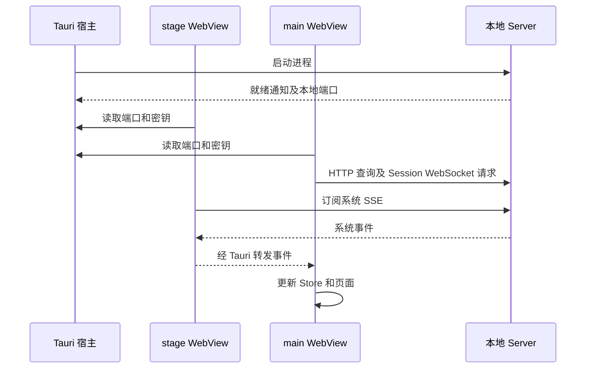

# Desktop

[English](./README.md)

Ema 桌面应用包含角色舞台, 以及聊天和设置窗口. React 渲染两个窗口的页面. Tauri 宿主管理原生窗口, 本地 Server 进程, 浏览器面板, 终端, 文件选择和桌面指针跟踪.

聊天窗口提供会话与项目导航, 流式回复和工具结果, 附件, 语音, 以及文件, Git 变更, 浏览器和终端工作区. 设置页修改的 Provider, 角色, Memory, Skills, MCP 和应用参数, 都是对话实际使用的 Server 数据.

## 从源码运行

在仓库根目录执行:

```sh
pnpm install --frozen-lockfile
pnpm dev:start
```

Node 和 pnpm 要求见[根 README](../../README-zh.md), 还需要 Rust 1.90 或更新版本及当前平台的 Tauri 构建环境. Live2D 所需的 Cubism Core 见下方发布说明.

Tauri 会启动 Server 开发进程和 Vite. Vite 使用 1420 端口, 分别以 `index.html` 和 `main.html` 提供舞台和主窗口页面. Server 另选本地端口, 由宿主把端口和认证密钥交给 WebView. 不需要把密钥写进前端配置文件.

`pnpm --filter @ema-agent/desktop dev` 只启动 Vite, 不会启动原生宿主, 也不能提供原生文件, 终端和浏览器操作.

## 数据如何到达页面



- HTTP 请求放在 `src/api`. 请求和响应形状从 Hono Route 类型推导, 仅类型导入不会把 Server 实现打进页面.
- Session WebSocket 发送聊天输入和交互回答, 接收会话实时事件. 重连后也从 Server 恢复当前会话的运行状态和待回答交互.
- 系统 SSE 由舞台窗口订阅, 主窗口接收转发的事件, 不重复建立同一系统订阅.
- 原生调用和跨窗事件经过 `src/lib/tauri/tauriBridge.ts`, 载荷类型在旁边的 `types.ts`. 修改原生接口时, 要同时核对 TypeScript 载荷, Rust 参数和命令注册.

Server 保存消息, 设置和资源. 前端 Store 保存当前导航, 草稿, 已加载历史, 运行中的任务等共享页面状态. 历史消息按窗口加载; 实时 Turn 要等对应的持久化历史读取成功后才从实时状态中移除.

设置页面从 `@ema-agent/server/settings` 导入定义, 对应 [definitions.ts](../server/src/settings/definitions.ts). Server 注册同一批对象. `settingsApi.getValue(definition)` 和 `putValue(definition, value)` 从定义取得 key 和值类型, 并按同一 Schema 检查响应. 标题和控件留在 Desktop. 共享控件与 `useSettingValues` 放在 `src/settings/shared`. 权限, 事件和屏幕捕获各有独立侧栏页面, 不放在参数设置中. 权限页包含确认超时和全局/项目规则, 事件页包含通知展示控制. 安全页保留沙箱和终端设置.

参数设置中的 Tools 管理内置工具启用状态. 后台进程是独立页面, 管理 Shell 并发数和运行时间限制, 沿用同一批配置定义与保存接口.

## 会话和窗口行为

主窗口在 Chat 和 Settings 之间切换时保留两个页面, 隐藏页面保留尺寸且不能获得焦点. 关闭主窗口只是隐藏; 退出应用才停止本地 Server 和原生终端.

普通切换会话会保留各会话的草稿, 工作区布局和手动终端. 归档或删除会话后, 清除它的聊天状态, 释放终端视图, 请求关闭宿主 PTY, 并清掉附件列表缓存. 不影响其他会话.

Permission 和 AskUser 共用各 Session 已有的交互队列. Windows 上, main 将各队首同步给原生宿主, 再由宿主判断前台 Chat 是否正在显示请求所属 Session, 是则不弹通知. Permission 按钮复用聊天的答复 API, AskUser 通知只负责打开 Chat 或关闭提示. 关闭通知不结束请求. `src/lib/notifications/interactionNotifications.ts` 中的主窗口订阅在 main 隐藏时仍保留. 原生注册, 前台判断与平台限制见[宿主文档](./src-tauri/README-zh.md#windows-交互通知).

原生文件拖放同时检查当前页面和指针位置. Chat 只接收中间聊天区的路径, 包括新对话页面, 不包含会话侧栏和右侧工作区. 已挂载但隐藏的 Chat 不接收设置页的拖放. 手动选择文件和 Chat 拖入共用草稿附件流程: 图片显示本地预览, 图片和粘贴文本在发送时保存到会话, 普通文件保留本地路径引用. 拖入文件不会自动发送消息.

壁纸设置卡片是独立的拖放目标. 它接收 PNG, JPEG 和 WebP 路径, 读取图片后复用文件选择的上传接口. Server 检查实际图片格式后才保存. 被拒绝的文件不会转交 Chat, 其他设置页面不接收这类文件拖放.

输入框上方的项目和 cwd 选择行只在新对话显示. 已有 Session 从 Header 菜单切换项目归属, cwd 保持不变. 标题和 cwd 仍保留各自的编辑入口.

角色全名链接打开 UI 包的 Dialog, 用表格显示 Narrative 导出的名单. 安全页默认显示简短的沙箱启动失败原因, 解码后的完整进程输出可展开查看, 展开和收起都使用共用过渡样式.

LLM 和 Vision 的创建页及高级配置提供可选 models.dev ID. 清空后保留已有模型和绑定, 停用目录刷新入口. 模型启停等后台更新期间保留卡片挂载. 供应商详情区分未验证与已保存的失败, Vision Ping 明确只检查文本连通性, 不表示图片能力或绑定已经验证. 选模与目录规则见 [Providers](../../src/providers/README-zh.md).

语音生成与播放分开处理. 停止播放不等于取消生成. 存储详情中的已保存音频可以独立试听, 不驱动角色口型.

STT 语音输入属于开始录音时的草稿, 不属于当前显示的输入框组件. 切换 Session 会立即停止原录音并释放麦克风, 已录音频继续转写并追加到原 Session 的最新草稿. 新 Session 可以独立录音, 不必等待之前的转写结束. 返回原 Session 时显示它的转写状态和取消入口. 如果切换时还在等待麦克风授权, 则丢弃这次操作, 迟到的音频流会直接关闭, 不开始录音. 主动取消, 归档或删除会话会丢弃对应的语音操作. 新对话首发创建 Session 时, 尚未完成的语音输入随草稿一起迁移. 这些操作保存在主窗口内存中, 不提供重启恢复. 实现见 [voiceInput.ts](./src/chat/input/voiceInput.ts).

Live2D 模型包读取, 初始化和渲染失败会在舞台上显示原因及重新加载按钮. 重新加载会再次获取当前模型并创建新的渲染器. 旧模型请求的失败不会覆盖当前角色的舞台.

舞台在 React 加载前就显示启动提示, 随后区分 Server 启动与角色加载. Live2D 成功绘制首帧后, 加载提示才淡出. Server 和角色呈现读取失败可以重试, 缺少资源会显示原因, 主动选择空白舞台则保持空白.

窗口最小化或隐藏不会让应用主动停止 Live2D 的 ticker. 可见性仍用于收起浮动控件和暂停隐藏页面的查询. WebView 或操作系统可以独立限制后台帧回调, 因此不保证最小化后的固定帧率.

Memory 存储展示独立于预览和最近处理记录加载, 只显示包含内部 Git 数据的文件字节数, 不显示容量环或百分比. 页面可见时每 30 秒刷新, 刷新期间保留上次结果, 失败后可以重试. 隐藏页面暂停请求. 这项展示不改变 Memory 维护规则.

默认用户目录是 `~/.ema-agent`, 可用 `EMA_PROFILE_DIR` 改选. 开发版和安装版可以使用同一目录, 安装不会自动建立一套空白用户数据. 资源初始化, 退出清理, 日志和平台行为见[原生宿主文档](./src-tauri/README-zh.md).

## 从哪里看代码

按需要修改的业务追踪, 不必先读完全部 Store.

| 问题 | 入口 |
| --- | --- |
| 两个窗口如何启动? | `src/main.tsx`, `src/windows/main.tsx`, `src/App.tsx`, 然后看 `src-tauri/src/lib.rs` |
| 输入和附件如何变成请求? | `src/chat/input` 中的 `submitChatDraft.ts`, 然后看 `src/api/sessionWebSocket.ts` |
| 历史消息和实时回复如何合并显示? | `src/chat/session`, `src/chat/history`, `src/stores/turn.ts` 和 `src/chat/messages` |
| 文件, 变更, 浏览器和终端如何工作? | `src/chat/sidePanel`, 然后追到对应 API 或 Tauri 入口 |
| 设置从哪里读取和保存? | `src/settings`, `src/api/settings.ts` 和 `src/stores/settings-sync.ts` |
| 舞台表情, 语音和点击穿透如何配合? | `src/stage`, `src/chat/presentation`, `src/chat/speech` 及原生窗口代码 |
| 样式应该改在哪里? | [样式文档](./src/styles/README-zh.md) |

## 生成安装包

使用 [release-config.json](./release-config.json) 指定的准确 Node 版本, 仓库指定的 pnpm 版本, 以及当前平台的 Rust/Tauri 构建工具. 在仓库根目录运行:

```sh
pnpm release
pnpm release --bundles msi
pnpm release --cubism-core /path/to/live2dcubismcore.min.js
pnpm release --server-only
```

默认生成 Windows NSIS, macOS DMG 或 Linux DEB. Windows 安装包输出在 `apps/desktop/src-tauri/target/release/bundle/nsis/`.

根目录 `package.json` 确定发布版本. `release.mjs` 在检查构建工具和准备文件之前, 要求 Desktop `package.json`, `src-tauri/tauri.conf.json` 和 `src-tauri/Cargo.toml` 中的 package 版本与它一致. 不一致时停止并列出四处的值, 不自动改写文件. 版本变化和 Bug 记录的写法见 [docs](../../docs/README-zh.md).

通过 `--cubism-core` 或 `EMA_CUBISM_CORE_PATH` 指定有权分发的 Cubism Core `06.00.0001`. 未指定时使用 `public/cubism/` 中的文件. SHA-256 必须符合 `release-config.json` 的批准值, 脚本不会自动下载这个许可文件.

`--target` 必须与当前 Rust host 相同, 因为 Node, SQLite, Sharp 和 FFmpeg 包含平台相关文件. 显式指定 target 后, 安装包输出在 `src-tauri/target/<target>/release/bundle/`. 这不是跨平台交叉构建流程.

四个发布脚本分别处理:

1. `release.mjs` 检查版本和资源, 构建当前 Server 及工作区依赖, 执行后续发布步骤.
2. `releaseWorkspace.mjs` 准备临时依赖工作区, 用 hoisted 布局安装锁定的生产依赖, 再组装由普通文件组成的 `server/app`. 必需的嵌套依赖版本保留, pnpm 链接和开发命令入口不进入安装包.
3. `releaseCheck.mjs` 检查发布版本和文件, 删除临时依赖工作区后用随包 Node 启动 Server. 使用全新临时用户目录验证启动, 认证, 角色初始化, 空会话和 Memory 路径.
4. `releaseNativeCheck.mjs` 检查组装结果中的 SQLite 剧情初始化, Sharp 和 FFmpeg.

验证成功后, 文件写入 `src-tauri/.release-staging/server/app` 和 `src-tauri/binaries/ema-server-<target>`. Tauri 将它们映射到安装资源, 包括运行必需的 `server` 目录. 这些生成文件应重新构建, 不手动修改. 发布准备不会改写开发仓库的依赖目录和锁文件.

`--server-only` 仍会构建, 安装生产依赖并执行独立运行检查, 但跳过 Cubism Core 验证和安装包生成. 检查允许等待 Server 就绪最多 120 秒.

生成安装包不等于安装和桌面验收. 发布前还要在真实安装目录检查启动, 退出, 文件拖放, 浏览器显隐, 终端, Live2D, 声音和已有用户目录的使用. 构建工具下载和签名要求仍可能单独失败.

## 验证修改

在仓库根目录运行:

```sh
pnpm --filter @ema-agent/desktop typecheck
pnpm --filter @ema-agent/desktop test
pnpm --filter @ema-agent/desktop test:scripts
pnpm --filter @ema-agent/desktop test:live2d-release
pnpm --filter @ema-agent/desktop build
cargo test --locked --manifest-path apps/desktop/src-tauri/Cargo.toml --lib
```

`test:live2d-release` 构建实际舞台和预览, 按 `tauri.conf.json` 的 CSP 加载本地 Cubism Core. 检查实际像素, 动作播放, 表情替换, 嘴部开合, 模型切换和资源释放, 包括失败导入的清理. 将 `EMA_LIVE2D_SAMPLES_PATH` 设为 CubismWebSamples 的 `Samples/Resources` 目录, 可以在随包 Ema 之外加入 Hiyori, Haru, Wanko 和 Ren. 测试只读取该目录, 不把示例导入用户资料.

测试使用临时目录, 本地 HTTP 服务和无界面的 Windows Edge. 其他平台先运行 `pnpm --filter @ema-agent/desktop exec playwright install chromium` 安装测试浏览器. 不检查原生窗口控件或实际听感.

其他前端测试会模拟原生 IPC. 默认 Rust 测试覆盖资源准备, 启动日志, Windows 进程退出, 通知载荷和 Windows COM 点击回调往返, 不展示或点击真实通知横幅. 显式开启的 Windows 投递检查见[宿主文档](./src-tauri/README-zh.md#从哪里看与如何验证). 这些检查不能替代安装版验收. 修改 Rust 后需要重启 Tauri 宿主, 前端 HMR 不会更新原生代码.
