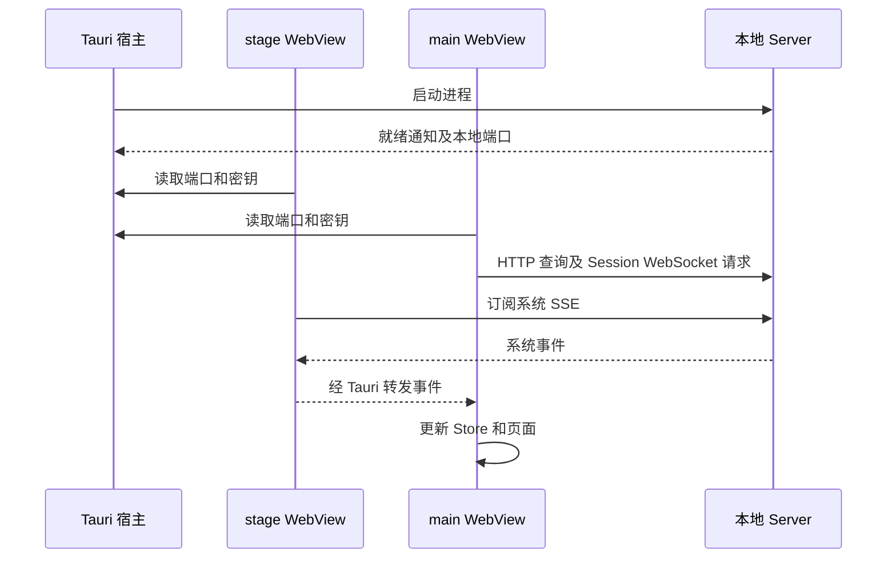

# Desktop

[English](./README.md)

Ema 桌面应用包含角色舞台, 以及聊天和设置窗口. React 渲染两个窗口的页面. Tauri 宿主管理原生窗口, 本地 Server 进程, 浏览器面板, 终端, 文件选择和桌面指针跟踪.

聊天窗口提供会话与项目导航, 流式回复和工具结果, 附件, 语音, 以及文件, Git 变更, 浏览器和终端工作区. 设置页修改的 Provider, 角色, Memory, Skills, MCP 和应用参数, 都是对话实际使用的 Server 数据.

## 从源码运行

在仓库根目录执行:

```sh
pnpm install --frozen-lockfile
pnpm dev:start
```

Node 和 pnpm 要求见[根 README](../../README-zh.md), 还需要当前平台的 Rust 和 Tauri 构建环境. Live2D 所需的 Cubism Core 见下方发布说明.

Tauri 会启动 Server 开发进程和 Vite. Vite 使用 1420 端口, 分别以 `index.html` 和 `main.html` 提供舞台和主窗口页面. Server 另选本地端口, 由宿主把端口和认证密钥交给 WebView. 不需要把密钥写进前端配置文件.

`pnpm --filter @ema-agent/desktop dev` 只启动 Vite, 不会启动原生宿主, 也不能提供原生文件, 终端和浏览器操作.

## 数据如何到达页面



- HTTP 请求放在 `src/api`. 请求和响应形状从 Hono Route 类型推导, 仅类型导入不会把 Server 实现打进页面.
- Session WebSocket 发送聊天输入和交互回答, 接收会话实时事件. 重连后也从 Server 恢复当前会话的运行状态和待回答交互.
- 系统 SSE 由舞台窗口订阅, 主窗口接收转发的事件, 不重复建立同一系统订阅.
- 原生调用和跨窗事件经过 `src/lib/tauri/tauriBridge.ts`, 载荷类型在旁边的 `types.ts`. 修改原生接口时, 要同时核对 TypeScript 载荷, Rust 参数和命令注册.

Server 保存消息, 设置和资源. 前端 Store 保存当前导航, 草稿, 已加载历史, 运行中的任务等共享页面状态. 历史消息按窗口加载; 实时 Turn 要等对应的持久化历史读取成功后才从实时状态中移除.

## 会话和窗口行为

主窗口在 Chat 和 Settings 之间切换时保留两个页面, 隐藏页面保留尺寸且不能获得焦点. 关闭主窗口只是隐藏; 退出应用才停止本地 Server 和原生终端.

普通切换会话会保留各会话的草稿, 工作区布局和手动终端. 归档或删除会话后, 清除它的聊天状态, 释放终端视图, 请求关闭宿主 PTY, 并清掉附件列表缓存. 不影响其他会话.

手动选择文件和原生文件拖入共用草稿附件流程. 拖放位置只匹配中间聊天区, 包括新对话页面, 不包含会话侧栏和右侧工作区. 图片进入图片分支并显示本地预览. 图片和粘贴文本在发送时保存到会话, 普通文件保留本地路径引用. 拖入文件不会自动发送消息.

语音生成与播放分开处理. 停止播放不等于取消生成. 存储详情中的已保存音频可以独立试听, 不驱动角色口型.

默认用户目录是 `~/.ema-agent`, 可用 `EMA_PROFILE_DIR` 改选. 开发版和安装版可以使用同一目录, 安装不会自动建立一套空白用户数据. 资源初始化, 退出清理, 日志和平台行为见[原生宿主文档](./src-tauri/README-zh.md).

## 从哪里看代码

按需要修改的业务追踪, 不必先读完全部 Store.

| 问题 | 入口 |
| --- | --- |
| 两个窗口如何启动? | `src/main.tsx`, `src/windows/main.tsx`, `src/App.tsx`, 然后看 `src-tauri/src/lib.rs` |
| 输入和附件如何变成请求? | `src/chat/input` 中的 `submitChatDraft.ts`, 然后看 `src/api/sessionWebSocket.ts` |
| 历史消息和实时回复如何合并显示? | `src/chat/session`, `src/chat/history`, `src/stores/turn.ts` 和 `src/chat/messages` |
| 文件, 变更, 浏览器和终端如何工作? | `src/chat/sidePanel`, 然后追到对应 API 或 Tauri 入口 |
| 设置从哪里读取和保存? | `src/settings`, `src/api/settings.ts` 和 `src/stores/settings-sync.ts` |
| 舞台表情, 语音和点击穿透如何配合? | `src/stage`, `src/chat/presentation`, `src/chat/speech` 及原生窗口代码 |
| 样式应该改在哪里? | [样式文档](./src/styles/README-zh.md) |

## 生成安装包

使用 [release-config.json](./release-config.json) 指定的准确 Node 版本, 仓库指定的 pnpm 版本, 以及当前平台的 Rust/Tauri 构建工具. 在仓库根目录运行:

```sh
pnpm release
pnpm release --bundles msi
pnpm release --cubism-core /path/to/live2dcubismcore.min.js
pnpm release --server-only
```

默认生成 Windows NSIS, macOS DMG 或 Linux DEB. Windows 安装包输出在 `apps/desktop/src-tauri/target/release/bundle/nsis/`.

通过 `--cubism-core` 或 `EMA_CUBISM_CORE_PATH` 指定有权分发的 Cubism Core. 未指定时使用 `public/cubism/` 中的文件. SHA-256 必须符合 `release-config.json` 的批准值, 脚本不会自动下载这个许可文件.

`--target` 必须与当前 Rust host 相同, 因为 Node, SQLite, Sharp 和 FFmpeg 包含平台相关文件. 显式指定 target 后, 安装包输出在 `src-tauri/target/<target>/release/bundle/`. 这不是跨平台交叉构建流程.

四个发布脚本分别处理:

1. `release.mjs` 检查版本和资源, 构建当前 Server 及工作区依赖, 执行后续发布步骤.
2. `releaseWorkspace.mjs` 准备临时依赖工作区, 用 hoisted 布局安装锁定的生产依赖, 再组装由普通文件组成的 `server/app`. 必需的嵌套依赖版本保留, pnpm 链接和开发命令入口不进入安装包.
3. `releaseCheck.mjs` 检查文件, 删除临时依赖工作区后用随包 Node 启动 Server. 使用全新临时用户目录验证启动, 认证, 角色初始化, 空会话和 Memory 路径.
4. `releaseNativeCheck.mjs` 检查组装结果中的 SQLite 剧情初始化, Sharp 和 FFmpeg.

验证成功后, 文件写入 `src-tauri/.release-staging/server/app` 和 `src-tauri/binaries/ema-server-<target>`. Tauri 将它们映射到安装资源, 包括运行必需的 `server` 目录. 这些生成文件应重新构建, 不手动修改. 发布准备不会改写开发仓库的依赖目录和锁文件.

`--server-only` 仍会构建, 安装生产依赖并执行独立运行检查, 但跳过 Cubism Core 验证和安装包生成. 检查允许等待 Server 就绪最多 120 秒.

生成安装包不等于安装和桌面验收. 发布前还要在真实安装目录检查启动, 退出, 文件拖放, 浏览器显隐, 终端, Live2D, 声音和已有用户目录的使用. 构建工具下载和签名要求仍可能单独失败.

## 验证修改

在仓库根目录运行:

```sh
pnpm --filter @ema-agent/desktop typecheck
pnpm --filter @ema-agent/desktop test
pnpm --filter @ema-agent/desktop build
cargo test --locked --manifest-path apps/desktop/src-tauri/Cargo.toml --lib
```

前端测试会模拟原生 IPC, Rust 内联测试覆盖资源准备和启动日志. 两者都不能替代真实 WebView 和原生进程验收. 修改 Rust 后需要重启 Tauri 宿主, 前端 HMR 不会更新原生代码.
