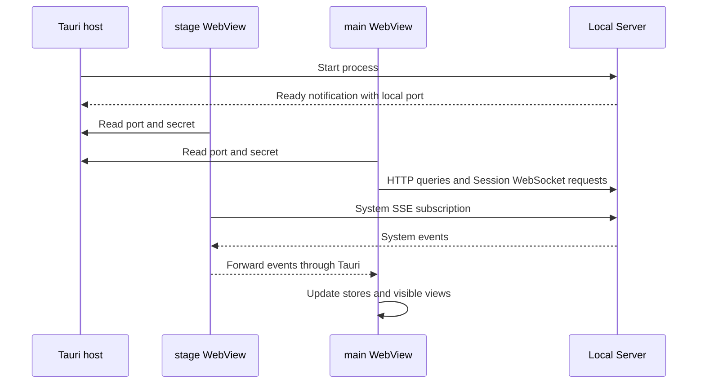

# Desktop

[中文](./README-zh.md)

Ema's desktop application combines a character stage with a chat and settings window. React renders both windows. The Tauri host manages native windows, the local Server process, browser panels, terminals, file dialogs, and desktop pointer tracking.

The chat window includes session and project navigation, streaming replies and tool results, attachments, speech, and a workspace with files, Git changes, browser tabs, and terminals. Settings edit the same Server-owned providers, characters, Memory, Skills, MCP, and application parameters used during conversations.

## Run from source

From the repository root:

```sh
pnpm install --frozen-lockfile
pnpm dev:start
```

Use the Node and pnpm requirements in the [root README](../../README.md), plus the Rust and Tauri build prerequisites for the current platform. Live2D also needs the licensed Cubism Core file described below.

Tauri starts the Server development process and Vite. Vite serves the stage at `index.html` and the main window at `main.html`, on port 1420. The Server chooses a separate local port; the host supplies that port and an authentication secret to the WebViews. Do not put the secret in a frontend configuration file.

`pnpm --filter @ema-agent/desktop dev` runs only Vite. It does not start the native host or provide native file, terminal, or browser operations.

## How data reaches the page



- HTTP calls live in `src/api`. Hono route types describe request and response shapes; type-only Server imports do not bundle the Server implementation into the page.
- Session WebSockets send chat input and interaction responses and receive live session events. They also restore the current session's running work and pending interactions after reconnecting.
- The stage owns the system SSE connection. The main window receives forwarded events rather than opening a duplicate system subscription.
- Native calls and cross-window events go through `src/lib/tauri/tauriBridge.ts`. Payload types live beside it in `types.ts`. A native change requires matching TypeScript payloads, Rust arguments, and command registration.

The Server saves messages, settings, and resources. Frontend stores hold current navigation, drafts, loaded history, active work, and other shared page state. History is loaded in windows; live Turn data is removed only after the corresponding saved history has been loaded.

## Session and window behavior

The main window keeps Chat and Settings mounted when switching views. Hidden views retain their dimensions and cannot receive focus. Closing the main window hides it; quitting the application stops the local Server and native terminals.

Switching sessions keeps each session's draft, workspace layout, and manual terminals. Archiving or deleting a session removes its chat state, releases its terminal views, requests PTY closure, and evicts its attachment list. Deleting one session does not clear another session's state.

File selection and native file drops share the draft attachment flow. Drop coordinates are checked against the middle chat area, including a new conversation page, not the session sidebar or right workspace. Images use the image branch and get a local preview. Images and pasted text are saved to a session when submitted; ordinary files remain local path references. Dropping a file does not send the message.

Speech generation and playback are separate. Stopping playback does not cancel generation. Saved audio can be played from storage details without driving the character's mouth.

The default profile is `~/.ema-agent`, unless `EMA_PROFILE_DIR` selects another directory. Development and installed builds can use the same profile. Installation does not provide a separate empty data directory. See the [native host documentation](./src-tauri/README.md) for resource initialization, process shutdown, logs, and platform details.

## Find the implementation

Follow the feature you are changing rather than reading every store first.

| Question | Start here |
| --- | --- |
| How do the two windows start? | `src/main.tsx`, `src/windows/main.tsx`, `src/App.tsx`, then `src-tauri/src/lib.rs` |
| How do input and attachments become a request? | `src/chat/input`, especially `submitChatDraft.ts`, then `src/api/sessionWebSocket.ts` |
| How do saved history and live replies appear together? | `src/chat/session`, `src/chat/history`, `src/stores/turn.ts`, and `src/chat/messages` |
| How do files, reviews, browser tabs, and terminals work? | `src/chat/sidePanel`, then the corresponding API or Tauri entry |
| Where are settings read and saved? | `src/settings`, `src/api/settings.ts`, and `src/stores/settings-sync.ts` |
| Where do stage expressions, speech, and input passthrough meet? | `src/stage`, `src/chat/presentation`, `src/chat/speech`, and the native window code |
| Where should a style change go? | [Styles README](./src/styles/README.md) |

## Build an installer

Use the exact Node version in [release-config.json](./release-config.json), the repository's pnpm version, and the current platform's Rust/Tauri build tools. From the repository root:

```sh
pnpm release
pnpm release --bundles msi
pnpm release --cubism-core /path/to/live2dcubismcore.min.js
pnpm release --server-only
```

The default bundle is Windows NSIS, macOS DMG, or Linux DEB. Windows installers are written to `apps/desktop/src-tauri/target/release/bundle/nsis/`.

`--cubism-core` or `EMA_CUBISM_CORE_PATH` supplies a Cubism Core file that you have permission to distribute. Without either, the script uses `public/cubism/`. Its SHA-256 must match the approved value in `release-config.json`; the script does not download this licensed file.

`--target` must match the current Rust host because Node, SQLite, Sharp, and FFmpeg contain platform-specific files. An explicit target places bundles under `src-tauri/target/<target>/release/bundle/`. This is not a cross-compilation workflow.

The four release scripts have these roles:

1. `release.mjs` checks versions and assets, builds the current Server and its workspace dependencies, and runs the remaining steps.
2. `releaseWorkspace.mjs` prepares a temporary dependency workspace, installs locked production dependencies with a hoisted layout, and assembles ordinary files into `server/app`. It preserves required nested dependency versions and excludes pnpm's links and development command entries.
3. `releaseCheck.mjs` checks the assembled files and starts the bundled Node after the temporary dependency workspace has been removed. A fresh temporary profile verifies startup, authentication, character initialization, empty sessions, and Memory paths.
4. `releaseNativeCheck.mjs` checks SQLite story initialization, Sharp, and FFmpeg in the assembled application.

Successful checks are copied to `src-tauri/.release-staging/server/app` and `src-tauri/binaries/ema-server-<target>`. Tauri maps them into the installed resources, including the required `server` directory. These generated files should be rebuilt, not edited by hand. The repository's development dependencies and lockfile are not rewritten by release preparation.

`--server-only` still builds, installs production dependencies, and performs the standalone checks, but skips Cubism Core validation and installer creation. Server readiness may take up to 120 seconds during this check.

Installer generation is not installation or desktop acceptance testing. Before publishing, install into a real directory and check startup, exit, file drops, browser visibility, terminals, Live2D, sound, and use of an existing profile. Build-tool downloads and signing requirements can still fail independently of the Server checks.

## Verify changes

From the repository root:

```sh
pnpm --filter @ema-agent/desktop typecheck
pnpm --filter @ema-agent/desktop test
pnpm --filter @ema-agent/desktop build
cargo test --locked --manifest-path apps/desktop/src-tauri/Cargo.toml --lib
```

Frontend tests use mocks for native IPC. Rust's inline tests cover resource preparation and launch logs. Neither replaces testing real WebViews and native processes. Restart the Tauri host after Rust changes; frontend HMR does not reload native code.
