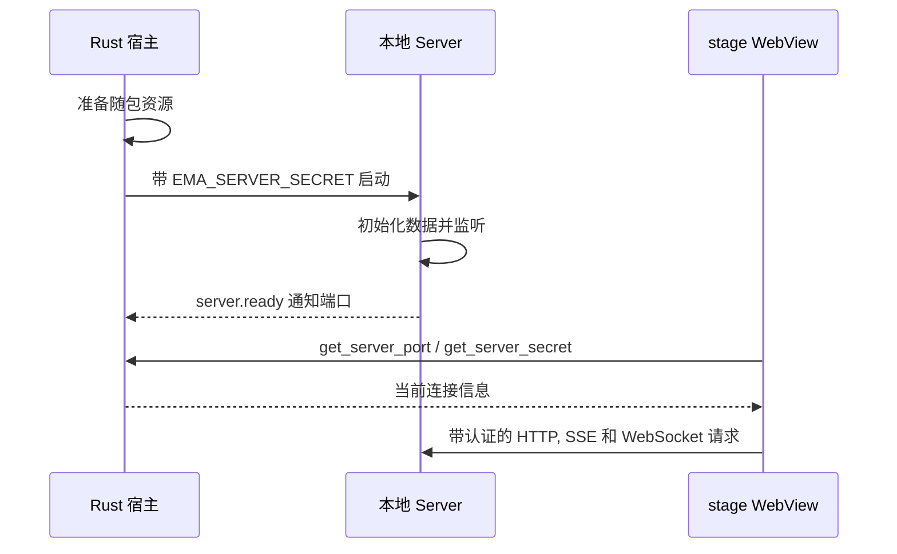

# Desktop 原生宿主

[English](./README.md)

这个 Rust 包负责 Ema 的原生窗口和桌面能力. 它创建角色舞台与聊天窗口, 启动本地 Server, 并提供浏览器面板, 终端, 托盘菜单, 文件选择和系统鼠标跟踪.

## 启动与用户数据

`lib.rs` 注册 Tauri 插件和命令. 应用先显示 `stage` 角色舞台, 用户打开聊天时才创建 `main` 窗口.

启动 Server 前, 宿主先准备随包模型目录和角色资源. 默认用户目录是 `~/.ema-agent`, 可用 `EMA_PROFILE_DIR` 覆盖. 已有 `profile.db` 时不再补种内置角色; 模型目录只在文件缺失时复制. 正式版安装位置不会另建一份用户数据.



Server 自行选择本机端口. 宿主最多等待 120 秒收到就绪通知, 同时检查进程是否提前退出. 开发时 `tsx watch` 重启 Server 可能换端口, 后续就绪通知会更新宿主保存的连接信息.

开发版从仓库启动 `pnpm --filter @ema-agent/server dev`. 正式版启动随包的 `ema-server`, 它是为发布重命名的 Node, 工作目录为 `server/app`, 入口参数为 `./dist/main.js`. 安装目录里的 `server` 包含运行所需代码与依赖, 不能删除.

## 窗口与事件

- 关闭聊天窗口只隐藏窗口, 不销毁 WebView, 已提交的会话工作继续运行.
- 舞台在点击穿透时仍可跟踪系统鼠标, 托盘菜单可以恢复普通交互.
- 系统事件和舞台控制通过具名 Tauri 事件传递. 前端入口是 [tauriBridge.ts](../src/lib/tauri/tauriBridge.ts), 载荷类型在 [types.ts](../src/lib/tauri/types.ts).
- 外部浏览器面板是独立的子 WebView, 由前端控制位置和显隐. 网页请求新窗口时交给系统浏览器.
- 自有应用窗口使用 `desktop/windows.rs` 配置的 Windows WebView2 媒体设置. 不为外部浏览器面板授予这些应用权限.

## 原生命令

命令入口放在 `src/commands`, 具体实现使用 `src/desktop` 和 `src/processes` 中的模块.

| 前端操作 | 原生入口 |
| --- | --- |
| 读取 Server 连接信息 | `get_server_port`, `get_server_secret` |
| 显隐聊天, 退出, 舞台置顶和点击穿透 | `open_main_window`, `hide_main_window`, `quit_app`, `set_always_on_top`, 鼠标与穿透命令 |
| 预览草稿图片和检查拖入路径 | `read_draft_image`, `inspect_attachment_paths` |
| 打开本机路径和枚举字体 | `open_path`, `list_system_fonts` |
| 创建和控制浏览器面板 | `commands/browser.rs` 中的命令 |
| 打开, 写入, 调整和关闭 PTY 终端 | `commands/terminal.rs` 中的命令 |

终端的 Shell 候选由 Server 的 System API 探测, 不是 Tauri 命令. `open_terminal` 接收选中的 `shell: { kind, path }`, 终端尺寸, 工作目录和输出用的 IPC Channel. Rust 根据 `kind` 决定启动参数. 归档或删除会话会请求关闭它的 PTY, 普通切换会话则保留运行. 退出应用会关闭全部 PTY.

文件拖入使用 Tauri 的 WebView 拖放事件. 前端先把物理坐标换成页面坐标, 检查是否位于中间聊天区, 再复用草稿附件流程接收路径. 侧栏 Session 排序是另一套页面交互.

## 退出与日志

正常退出时先关闭全部 PTY, 再停止 Server 及其子进程. Windows 使用 Job Object 和进程树终止. macOS 与 Linux 使用独立进程组, 先发 TERM, 超时后再发 KILL.

启动日志写入用户目录的 `logs` 下. `logging.rs` 同时输出到终端, 并清理过期启动日志. Server stdout 同时包含启动消息和就绪通知, 由 `processes/child.rs` 区分协议消息与普通日志.

## 从哪里看与如何验证

先看 `lib.rs`, Server 启动看 `processes/desktop_processes.rs`, 窗口行为看 `desktop/windows.rs`. 修改 IPC 时需要一起核对前端具名方法, Rust 命令参数和命令注册.

在仓库根目录运行:

```sh
cargo check --locked --manifest-path apps/desktop/src-tauri/Cargo.toml
cargo test --locked --manifest-path apps/desktop/src-tauri/Cargo.toml --lib
```

现有内联测试覆盖资源准备, 启动日志内容和过期日志清理. 它们不能代替真实 WebView 输入, 文件拖入, 浏览器显隐和 PTY 交互验收. 这些操作用 `pnpm --filter @ema-agent/desktop tauri:dev` 检查. 发布准备和安装包命令见 [Desktop README](../README.md).
