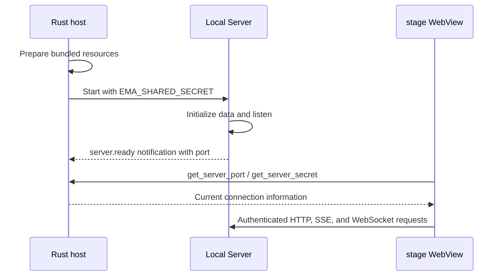

# Desktop host

[中文](./README-zh.md)

This Rust crate runs the native part of Ema. It creates the character stage and chat window, starts the local Server, and provides the browser panels, terminal sessions, tray menu, file dialogs, and desktop pointer tracking used by the frontend.

## Startup and data

`lib.rs` installs the Tauri plugins and command handlers. The stage window opens first. The chat window, labeled `main`, is created when the user opens it.

Before starting Server, the host prepares the bundled model catalog and character resources in the profile directory. The default profile is `~/.ema-agent`; `EMA_PROFILE_DIR` overrides it. An existing `profile.db` prevents reseeding built-in characters. The model catalog is copied only when missing. Installing a release does not create a separate user profile.



Server chooses a local port. The host waits up to 120 seconds for its ready notification and also detects early process exit. In development, `tsx watch` may restart Server with a different port; subsequent ready notifications update the connection information returned to the frontend.

Development launches `pnpm --filter @ema-agent/server dev` from the repository. A release launches the bundled `ema-server` executable, which is Node renamed for distribution, with `server/app` as its working directory and `./dist/main.js` as its entry. Keep the installed `server` directory beside the application resources; it contains required code and dependencies.

The host sets `NODE_ENV=development` for debug builds and `NODE_ENV=production` for release builds. Release children do not inherit `NODE_OPTIONS` or `NODE_PATH`. This matches the release preparation check and prevents shell-level Node settings from changing the installed Server.

## Page content policy

`tauri.conf.json` permits HTTP and HTTPS images and audio for Markdown, plus local and Blob media used by the application. JavaScript `unsafe-eval` stays disabled; Cubism's WebAssembly permission is separate.

Tauri's automatic CSP modification is disabled only for `style-src`. File trees, Diff views and xterm create style elements at runtime. Adding a nonce to that directive would make the browser ignore its `unsafe-inline` permission and reject those elements. Other directives retain normal Tauri processing. Both application window capabilities separately grant `core:window:allow-set-theme` for native theme changes.

## Windows and events

- Closing the chat window hides it rather than destroying its WebView. Existing session work continues.
- The stage can track the system pointer while clicks pass through it. The tray menu can restore normal interaction.
- System events and stage controls pass through named Tauri events. Their frontend entry is [tauriBridge.ts](../src/lib/tauri/tauriBridge.ts), with payload types in [types.ts](../src/lib/tauri/types.ts).
- External browser panels are separate child WebViews. The frontend controls their bounds and visibility. New-window requests open through the system browser.
- Own application WebViews receive the Windows WebView2 media settings configured in `desktop/windows.rs`. External browser panels do not receive those application permissions.

## Native commands

Command handlers live in `src/commands`. Their implementations use the corresponding modules in `src/desktop` and `src/processes`.

| Frontend operation | Native entry |
| --- | --- |
| Read Server connection information | `get_server_port`, `get_server_secret` |
| Show or hide chat, exit, pin stage, control click-through | `open_main_window`, `hide_main_window`, `quit_app`, `set_always_on_top`, pointer and passthrough commands |
| Read local image bytes for a draft preview or wallpaper upload; inspect attachment paths | `read_local_image`, `inspect_attachment_paths` |
| Select paths for chat attachments, wallpapers, or character resources | `select_paths` |
| Open a local path or enumerate fonts | `open_path`, `list_system_fonts` |
| Create and control browser panels | Commands in `commands/browser.rs` |
| Open, write, resize, and close PTY terminals | Commands in `commands/terminal.rs` |

Terminal shell candidates come from the Server's system API, not a Tauri command. `open_terminal` accepts a selected `shell: { kind, path }`, dimensions, a working directory, and an IPC Channel for output. Rust chooses launch arguments from `kind`. Archiving or deleting a session requests closure of its PTYs; ordinary session switching keeps them running. Application exit closes all PTYs.

File drops use Tauri's WebView drag events. The frontend converts physical coordinates to page coordinates and checks the active page and target bounds. Visible Chat uses the middle chat area and the draft attachment flow. Wallpaper settings use the wallpaper card and the image upload API, whose Server implementation validates image content. Hidden Chat and other settings pages do not accept these drops. Sidebar session reordering is a separate page interaction.

`select_paths` returns selected paths, or an empty array on cancellation. On Windows it opens the picker without an owner so the main window remains interactive. macOS and Linux retain the parent window. Only one picker through this entry may be pending; dropping the awaiting receiver does not release that slot before the native callback finishes. Working-directory, project, and Data backup dialogs keep their existing entry points.

Callers retain the destination chosen when opening the picker. Chat appends to the originating Session's latest draft, but discards a late result after that draft enters submission. Reference-audio selection is ignored after its form closes, changes character, or submits. Wallpaper changes are queued only after an operation is requested, not while a picker waits; imports read current saved settings before merging new images.

## Exit and logs

Normal application exit closes all PTYs and stops Server and its child processes. Windows uses a Job Object and process-tree termination. macOS and Linux use a process group, try TERM, and use KILL if the group does not exit in time.

Launch logs are written below the profile's `logs` directory. `logging.rs` also writes to the terminal and removes expired launch logs. Server stdout carries both startup messages and ready notifications; `processes/child.rs` separates the ready protocol from ordinary log output.

## Read and verify

Start with `lib.rs`, then follow `processes/desktop_processes.rs` for Server startup and `desktop/windows.rs` for window behavior. A frontend IPC change needs matching command registration, Rust arguments, and TypeScript payloads.

From the repository root:

```sh
cargo check --locked --manifest-path apps/desktop/src-tauri/Cargo.toml
cargo test --locked --manifest-path apps/desktop/src-tauri/Cargo.toml --lib
```

The Rust tests cover resource preparation, launch-log output and retention, and path-picker state. They do not verify real WebView input, native picker interaction, file dragging, browser visibility, or PTY interaction. Run `pnpm --filter @ema-agent/desktop tauri:dev` for those checks. Native window changes require restarting the host; frontend HMR is not sufficient. Release preparation and installer commands are documented in the [Desktop README](../README.md).

