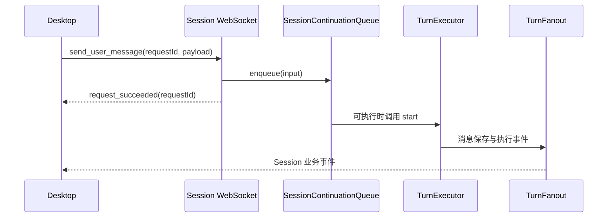

# Server

[English](./README.md)

这个应用是 Ema 的本机后端. 它打开数据库, 连接各业务包, 执行对话与工具, 并处理桌面发来的 HTTP, WebSocket 和 SSE 请求.

桌面把它作为子进程启动并提供共享密钥. Server 只监听 `127.0.0.1`, 端口由操作系统分配. 安装包包含 Node 程序和 Server 文件, 用户不需要自行安装开发用的 Node 或 pnpm.

## 从源码运行

先完成[项目 README](../../README-zh.md) 中的安装和构建步骤. 桌面开发命令会自动启动 Server. 如果在 PowerShell 中单独运行:

```powershell
$env:EMA_SHARED_SECRET = node -e "process.stdout.write(require('node:crypto').randomBytes(32).toString('hex'))"
$env:EMA_INITIALIZE_BUILTIN_CHARACTERS = '1'
pnpm --filter @ema-agent/server dev
```

`EMA_SHARED_SECRET` 至少 32 个字符. `EMA_INITIALIZE_BUILTIN_CHARACTERS=1` 初始化内置角色数据行, 角色文件另外由桌面提供. 单独接入的客户端需要使用公布的端口和同一密钥.

`pnpm --filter @ema-agent/server build` 编译到 `dist`, `start` 执行 `dist/main.js`. 开发命令使用 `tsx watch`, 重启后端口可能改变.

## 启动和关闭

[main.ts](./src/main.ts) 先检查密钥, 再进入 [lifecycle.ts](./src/platform/lifecycle.ts). 启动顺序是:

1. 创建数据目录, 检查 Profile 锁文件.
2. 依次打开并迁移配置库, 会话库和 Narrative 剧情库. 会话库迁移接收已迁移的 Profile, 用于更新 Provider 引用. 见 [Storage 数据迁移](../../src/storage/README-zh.md#数据迁移).
3. 创建各业务对象并连接回调.
4. 暂停活动 Goal, 将中断的工具, 后台进程, Turn 和子 Agent 执行记录标记为结束. 不续跑其中的命令.
5. 挂载路由, 开始监听, 向 stdout 写入一行 JSON:

```json
{"jsonrpc":"2.0","method":"server.ready","params":{"port":12345}}
```

这里的端口只是示例. [桌面子进程读取代码](../desktop/src-tauri/src/processes/child.rs) 识别这条消息, 同一输出流里也可以有普通启动日志.

公布端口后启动文件维护, 外置工具结果清理和 Memory 任务恢复. MCP 先注册已缓存的工具定义, 再后台连接. 核心 Skill 目录也异步加载, 第一次使用时等待加载完成.

收到 SIGINT 或 SIGTERM 后, Server 关闭 WebSocket 和 HTTP 连接, 停止自动续接, 取消运行中的工作与语音, 停止后台命令, 通知 Memory 关闭, 最后关闭数据库并释放锁. 具体取消顺序见 [composition/index.ts](./src/composition/index.ts).

## 文件与数据库

`EMA_PROFILE_DIR` 可以覆盖 Profile 根目录, 默认是 `~/.ema-agent`. 它与软件的安装目录无关.

| Profile 下的位置 | 保存内容 |
| --- | --- |
| `profile.db` | Provider, 模型绑定, 角色, 设置, MCP 和 Skill 记录. |
| `data/data.db` | Session, Turn, 消息, Task, Goal, 工具执行, 用量和 Memory 任务. |
| `narrative/narrative.db` | 随应用提供的剧情及检索数据. |
| `profile/models-dev.json` | 本地 models.dev 目录. 只有显式刷新才下载, 打开供应商页面不会下载. |
| `characters/`, `wallpapers/` | 角色资源和受管壁纸. |
| `resources/skills/`, `skills/` | 内置技能和用户技能. |
| `memories/` | 正式 Work 与 Relationship 记忆文件. |
| `data/attachments/<sessionId>/` | 受管图片和粘贴文本. |
| `data/audio/<sessionId>/<turnId>/` | 各朗读角色生成的音频. |
| `data/web-fetch/<sessionId>/` | Session 内主 Agent 和子代理共用的 WebFetch 下载. 随 Session 删除, 纳入会话备份. |
| `data/tool-results/<sessionId>/` | 按年龄和容量回收的工具大文本. |
| `data/background-processes/<sessionId>/<processId>/` | 命令输出日志. |
| `data/scratchpad/<sessionId>/<turnId>/` | Turn 内共享的临时便签. |
| `data/.backup-temp/` | 导入与导出暂存, 独立于 Session 资源清理. |

[paths.ts](./src/platform/paths.ts) 确定 Profile 位置并执行文件清理. 共享资源路径由 [Storage dataPaths](../../src/storage/dataPaths.ts) 计算, 具体业务按需创建目录. 内置技能种子优先使用 `EMA_BUNDLED_SKILLS_DIR`, 否则使用源码目录中的资源路径; 目标目录存在时不覆盖.

删除 Session 时先等工作停止, 再删除数据行和文件. 归档则先保存归档状态, 再停止工作并保留历史. 批量删除提交后的清理失败单独返回, 不表示 SQL 删除已经回滚.

## 请求和事件

[createRoutes](./src/routes/index.ts) 挂载 HTTP 和 WebSocket 路由. 桌面通过[公共 HTTP 客户端](../desktop/src/api/client.ts) 的 Hono 类型化入口读取 `AppType`. 新增路由时要保留整条链的返回类型.

| 连接 | 用途 |
| --- | --- |
| HTTP | 列表, 历史, 设置, 资源, 模型配置, 上下文估算和备份等显式操作. |
| `/api/ws/session/:sessionId` | 用户输入, 排队控制, 权限回答, 取消, 手动压缩和 Session 事件. |
| `/api/system/events` | SSE 提示, 通知已打开窗口刷新应用级状态. |
| `/api/ws/speech/:turnId` | 语音生成状态和取消. |
| `/api/turns/:turnId/audio` | 音频字节, 包括仍在生成的响应. |

Session 请求的确认只表示请求被接受, 不表示 Turn 已完成:



`request_succeeded`, `request_rejected` 和手动压缩结果携带原来的 `requestId`, 公共业务事件不带. 每次连接先收到 `session_state`, 包含运行中的工作, 待回答交互和排队输入. 重连返回当前状态, 不重放断线期间的增量; 已保存正文通过 HTTP 读取.

TurnFanout 只消费一次 Turn 事件流, 把 Session 事件发给观察窗口, 把指定的活动提示发给 AppEvents, 并将文本增量交给可选的语音生成. 切换查看窗口本身不取消 Turn.

## 认证和输入限制

CORS 在认证前处理, 让 WebView 的预检请求通过. 除 `/health` 外, 实际请求需要 `X-Ema-Secret`. 浏览器 WebSocket 握手和明确允许的音频 GET 可以用 `?secret=` 提供同一密钥; 同时带请求头时以请求头为准. 普通文件读取不接受查询串认证.

这是具备本机文件访问能力的本地应用, 不是远程多用户文件服务.

[requestBudget.ts](./src/platform/requestBudget.ts) 在解析 JSON 或 multipart 前检查 HTTP 请求体大小. 普通 JSON 和 Turn 请求的传输上限各为 128 MiB, 音频和壁纸上传各为 256 MiB. 额度计算整个请求体, 包括编码后的数据和 multipart 字段. Live2D 导入提交和重新生成封面允许 base64 编码前最大 100 MiB 的 PNG 数据, 对应传输额度还包括 base64 增量和 JSON 字段. 业务包仍检查解码后的字节与实际文件格式, 外部模型服务也保留自己的限制. Session WebSocket 另外使用消息 Schema 和字段数量, 长度限制.

输入校验失败返回 `400`, 形状为 `error: "invalid_request"` 和展开后的错误详情. 已知业务错误由各路由映射 HTTP 状态, 未处理错误交给末尾的错误处理器, 返回 `internal_error`.

## 阅读和验证

先看 `main.ts` 和 `platform/lifecycle.ts`, 再从 `composition/index.ts` 进入所查业务. `routes/index.ts` 给出 URL, 具体路由定义传输形状. `application/` 保存跨业务协调, 如删除 Session 和切换角色.

角色切换, 删除和指定演出设置修改, 会在暂停新工作注册期间检查所有 Session 是否空闲.

`@ema-agent/server/settings` 导出[共享设置定义](./src/settings/definitions.ts). key, Schema, 默认值和生效时机仍由业务包持有; 这个入口只汇总定义, 不引入 Server 启动, SQL 或文件操作. `composition/settings.ts` 把同一批定义注册到 `SettingsStore`. Desktop 将定义传给设置 API, 不再重复写 key 和值类型. 外观常量也是可供浏览器使用的入口. 这些共享入口不能引入 Node 依赖.

```bash
pnpm --filter @ema-agent/server typecheck
pnpm --filter @ema-agent/server test
pnpm --filter @ema-agent/server build
```

测试使用临时目录或内存 SQLite, 覆盖路由响应, 真实本机 HTTP/WebSocket, Session 停止和删除顺序, 备份文件, 模型目录刷新及事件传输, 不调用真实付费模型. 类型检查通过不能代替安装版桌面或视觉交互验收.
