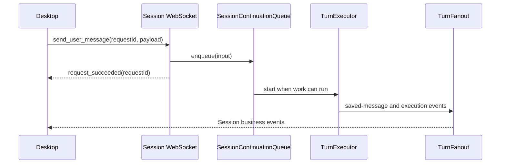

# Server

[中文](./README-zh.md)

This app runs Ema's local backend. It opens the databases, connects the business packages, runs conversations and tools, and serves the desktop's HTTP, WebSocket and SSE requests.

The desktop starts it as a child process and supplies a shared secret. It listens on `127.0.0.1` with an operating-system-assigned port. The installed app includes a Node executable and Server files; users do not need a development Node or pnpm installation.

## Run from source

Run workspace installation and the build steps in the [project README](../../README.md) first. The desktop development command starts Server automatically. For a standalone PowerShell session:

```powershell
$env:EMA_SHARED_SECRET = node -e "process.stdout.write(require('node:crypto').randomBytes(32).toString('hex'))"
$env:EMA_INITIALIZE_BUILTIN_CHARACTERS = '1'
pnpm --filter @ema-agent/server dev
```

`EMA_SHARED_SECRET` must contain at least 32 characters. `EMA_INITIALIZE_BUILTIN_CHARACTERS=1` initializes built-in character records; the desktop separately supplies bundled character files. Standalone clients must use the printed port and the same secret.

`pnpm --filter @ema-agent/server build` compiles to `dist`; `start` runs `dist/main.js`. Development uses `tsx watch`, so a restart can change the port.

## Startup and shutdown

[main.ts](./src/main.ts) checks the secret before starting [lifecycle.ts](./src/platform/lifecycle.ts). Startup then:

1. Creates the data directory and checks the Profile lockfile.
2. Opens and migrates the Profile, conversation and Narrative databases in that order. Existing Profile and conversation databases are copied before an upgrade; startup waits for each copy and migration to finish. A copy failure stops startup. See [Storage migrations](../../src/storage/README.md#migrations).
3. Constructs the business objects and connects their callbacks.
4. Pauses active Goals and records interrupted tools, background processes, Turns and subagent runs as ended. It does not resume their commands.
5. Builds the routes, listens, and writes one newline-terminated JSON message to stdout:

```json
{"jsonrpc":"2.0","method":"server.ready","params":{"port":12345}}
```

The port above is an example. [The desktop child-process reader](../desktop/src-tauri/src/processes/child.rs) reads this message; ordinary startup logs can appear on the same stream.

After publication, file maintenance, external tool-result cleanup and Memory job recovery start. MCP connects in the background after registering cached tool definitions. Core Skill loading also runs asynchronously; its first consumer waits for loading.

SIGINT and SIGTERM close WebSocket and HTTP connections, stop automatic continuation, cancel running work and speech, stop background commands, signal Memory shutdown, close databases and release the lock. The important cancellation order is in [composition/index.ts](./src/composition/index.ts).

## Files and databases

`EMA_PROFILE_DIR` overrides the Profile root. Its default is `~/.ema-agent`. It is independent of the application's installation directory.

| Location under the Profile | Content |
| --- | --- |
| `profile.db` | Providers, model bindings, characters, settings, MCP and Skill records. |
| `data/data.db` | Sessions, Turns, messages, tasks, Goals, tool executions, usage and Memory jobs. |
| `pre-migration/` | Database copies before Profile or Data upgrades, with three kept per database after successful migration. |
| `narrative/narrative.db` | The packaged story data and its retrieval tables. |
| `profile/models-dev.json` | The local models.dev catalog. Refresh is explicit, not triggered by opening a provider page. |
| `characters/`, `wallpapers/` | Character resources and managed wallpaper images. |
| `resources/skills/`, `skills/` | Built-in and user Skills. |
| `memories/` | Formal Work and Relationship Memory files. |
| `data/attachments/<sessionId>/` | Managed image and pasted-text files. |
| `data/audio/<sessionId>/<turnId>/` | Generated audio for each speaking character. |
| `data/web-fetch/<sessionId>/` | WebFetch downloads shared by the Session's main Agent and subagents. Removed with that Session and included in its backup. |
| `data/tool-results/<sessionId>/` | Large tool text subject to age and size cleanup. |
| `data/background-processes/<sessionId>/<processId>/` | Command output logs. |
| `data/scratchpad/<sessionId>/<turnId>/` | Temporary notes shared within a Turn. |
| `data/.backup-temp/` | Import/export staging, cleared separately from Session resources. |

[paths.ts](./src/platform/paths.ts) determines Profile locations and performs file cleanup. Shared resource paths come from [Storage dataPaths](../../src/storage/dataPaths.ts). Each business package creates its directories when needed. Built-in Skill seeds use `EMA_BUNDLED_SKILLS_DIR` when supplied, otherwise a source-tree resource path; an existing destination is not overwritten.

Session deletion waits for its work to stop before deleting database rows and files. Archiving saves the archived state first, then stops work while keeping history. Cleanup failures after committed bulk deletion are returned separately; they do not mean the SQL deletion was rolled back.

## Requests and events

[createRoutes](./src/routes/index.ts) mounts all HTTP and WebSocket routes. Desktop imports its `AppType` into [the HTTP client](../desktop/src/api/client.ts) through Hono's typed client. Keep the route chain's returned type intact when adding routes.

| Connection | Purpose |
| --- | --- |
| HTTP | Lists, history, settings, resources, model configuration, context estimates and explicit operations such as backup. |
| `/api/ws/session/:sessionId` | User input, queued-input control, permission answers, cancellation, manual compaction and Session events. |
| `/api/system/events` | SSE notifications that tell open windows to refresh shared application state. |
| `/api/ws/speech/:turnId` | Speech-generation state and cancellation. |
| `/api/turns/:turnId/audio` | Audio bytes, including an in-progress response. |

A Session request's acknowledgement means that request was accepted, not that the Turn finished:



`request_succeeded`, `request_rejected` and manual-compaction responses carry the original `requestId`. Shared business events do not. Each connection first receives `session_state`, including running work, pending interactions and queued input. Reconnection sends current state, not a replay of missed deltas; saved history is read through HTTP.

TurnFanout consumes the Turn event stream once. It forwards Session events, sends selected activity notifications to AppEvents, and passes text deltas to optional speech generation. Changing the viewing window does not by itself cancel a Turn.

## Authentication and input limits

CORS runs before authentication so WebView preflight requests can succeed. Real requests require `X-Ema-Secret`, except `/health`. Browser WebSocket handshakes and the explicitly allowed audio GET routes may put the same secret in `?secret=`; a supplied header takes precedence. General file reads do not accept query-string authentication.

This is a local application with authenticated local-file access, not a remote multi-user file service.

[requestBudget.ts](./src/platform/requestBudget.ts) checks HTTP body size before JSON or multipart parsing. Ordinary JSON and Turn requests each use a 128 MiB transport limit; audio and wallpaper uploads each use 256 MiB. These limits cover the complete request body, including encoded data and multipart fields. Live2D import commits and regenerated covers accept PNG data up to 100 MiB before base64 encoding; their transport budget also includes base64 expansion and JSON fields. Business packages still validate decoded bytes and actual file formats, and external model services retain their own limits. Session WebSocket messages have their own schemas and value limits.

Validation failures return `400` with `error: "invalid_request"` and flattened details. Individual routes map known business errors to HTTP statuses; unexpected errors reach the final handler and return `internal_error`.

## Read and verify

Start at `main.ts` and `platform/lifecycle.ts`, then follow `composition/index.ts` into the business being checked. `routes/index.ts` gives its URL; the route file defines the wire shape. `application/` contains operations that coordinate several packages, such as Session deletion and character changes.

Character activation, deletion and selected presentation changes temporarily block new work registration while checking that Sessions are idle.

`@ema-agent/server/settings` exports [shared setting definitions](./src/settings/definitions.ts). Business packages own their keys, schemas, defaults and apply policies; this entry collects them without importing Server startup, SQL or file access. `composition/settings.ts` registers the same definitions with `SettingsStore`. Desktop passes these definitions to its settings API instead of repeating key strings or value shapes. The appearance catalogs are also browser-safe imports. Keep Node dependencies out of these shared entries.

```bash
pnpm --filter @ema-agent/server typecheck
pnpm --filter @ema-agent/server test
pnpm --filter @ema-agent/server build
```

Tests use temporary directories or in-memory SQLite. They cover route responses, real local HTTP/WebSocket connections, Session stop/delete ordering, backup files, model-catalog refresh and event delivery. They do not call real paid model APIs. A successful typecheck is not an installed-desktop or visual interaction test.
