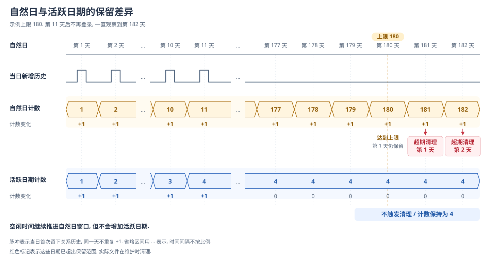

# 为什么这样设计 Memory

[English](README.md) | [文档入口](../../README-zh.md)

Memory 要保存会影响后续协作和相处的内容, 用户也需要能检查和纠正这些内容. 我们选择可编辑文本, 主要考虑速度, 关联维护的成本, 以及记忆是否容易查看和修改.

## 为什么放弃图结构

用图组织记忆时, 一条内容的变化可能牵动关联节点和关系. 更新时需要判断哪些关联内容也要调整. 如果只更新了一部分, 就可能留下相互冲突的记忆.

读取时也有类似问题: 命中一个节点, 不代表已经找齐理解它所需的关联内容. 保存得更有结构, 并不能自动证明本次检索拿到了完整背景.

当时的图方案速度也不理想. 我们没有认为继续增加图检索和维护逻辑, 就一定能换来足够可靠的结果. 因此选择把正式记忆保存成可编辑文本, 减少持续维护图关系的负担, 让用户能够直接检查和修改记忆内容.

这个决定针对 EmaAgent 的需求和当时的方案, 不是对所有图 RAG 算法完整性的结论. 我们不需要证明其他方案都不可行, 才能选择更容易承担的维护成本.

文本方案同样可能漏掉不同措辞的相同意思, 文件也需要整理. LLM 仍可能在提取和整合时误解内容. 我们接受这些限制, 优先让正式记忆可读, 可改, 并减少内容变化时需要同步维护的关联结构.

## 为什么区分 Work 与 Relationship

工作偏好可以影响不同角色提供的协作, 而一次角色之间的经历不应该自动变成所有角色共同拥有的回忆. 把它们混在一起, 容易让协作规则和角色关系互相干扰.

因此 Work 保存稳定的工作偏好, Relationship 保存用户背景和角色关系. 共用的用户事实与角色自己的经历也需要区分, 使角色能够了解同一个用户, 又不会直接继承其他角色的相处记录.

代价是提取和整理时需要判断内容属于哪一类. 分类仍可能出错, 文件可检查和可修改因此很重要.

## 为什么按活跃日期保留关系历史

我们希望限制持续积累的历史, 同时避免用户一段时间没有聊天, 回来时却发现旧的相处记录已经仅因时间流逝被清理.

按自然日保留很直观, 也能限制记录的年龄. 但空闲时间同样会推动这个窗口. 对使用不连续的用户, 记录还没被多少新经历替代, 就可能已经越过期限.

我们选择按每个角色最近若干个有历史文件的日期计数. 这里的活跃日期指实际留下关系历史的日期, 不是打开过应用的日期. 同一日期的多份历史只占一个日期, 没有新增日期就不会仅因空闲时间推移而挤掉旧记录. 保留范围因而更接近积累了多少天的经历.

下图用 180 作为示例上限. 第 1, 2, 10, 11 天各产生一个活跃日期, 之后直到第 182 天都没有再次登录. 自然日窗口包含当天及此前 179 天. `...` 省略中间的空闲时段.

第 180 天, 最早的一天仍在自然日范围内. 第 181 天起, 窗口每前进一天, 就有更早的一天超期. 图中的红色箭头直接标出过期清理的位置. 活跃日期则一直停在 4, 没有达到保留上限, 因而不触发这项清理. 到达上限不会把全部记录清空.

这个选择更照顾低频和间歇使用, 但不能限制历史最早可以追溯到多久. 每天留下的内容多少也不同, 日期数量不能保证固定的磁盘占用. 同一天大量聊天与只留下少量记录, 在这个计数中权重相同. 我们接受这种较粗的计算方式, 让空闲时间不会自动消耗历史的保留范围.

这项取舍用于角色关系的历史文件. 长期摘要承担整理后继续保留的内容, 不随这条日期规则一起清理. Work 的稳定工作偏好则根据内容是否仍然适用来整理, 当前没有按年龄删除正文的规则.

文件使用方式和维护约定见 [Memory 模块](../../../src/memory/README-zh.md). 具体保留数量属于可以调整的参数, 不决定这里为什么选择活跃日期.

