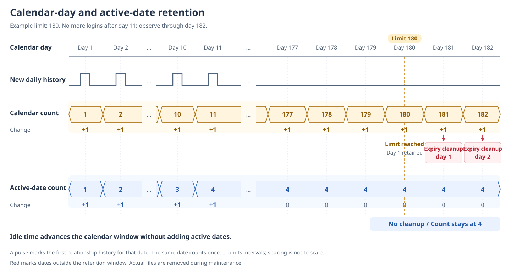

# Why Memory works this way

[中文](README-zh.md) | [Documentation](../../README.md)

Memory keeps information that affects future collaboration and relationships. The user also needs to inspect and correct it. We chose editable text with speed, the cost of maintaining relationships between memories, and direct inspection and editing in mind.

## Why we dropped the graph approach

In a graph of memories, changing one piece of content can also affect related nodes and edges. Updating it requires deciding which connected content needs to change. A partial update can leave conflicting memories behind.

Reading has a similar problem: finding one node does not establish that all the context needed to understand it has been retrieved. More structured storage does not itself prove that a particular query received the complete background.

The graph approach we tried was also slower than we wanted. We did not assume that adding more graph retrieval and maintenance logic would necessarily produce reliable enough results. We chose editable text for formal memories to reduce ongoing graph maintenance and let the user inspect and change the content directly.

This is a choice for EmaAgent's needs and the approach we tried, not a conclusion about the completeness of every graph RAG algorithm. We do not need to establish that all alternatives fail before choosing maintenance costs we can more readily support.

Text can also miss differently worded expressions of the same idea, and files still need organization. LLM extraction and consolidation can misinterpret content. We accept those limitations while prioritizing readable, editable memories and fewer connected structures to maintain when content changes.

## Why Work and Relationship are separate

Working preferences can guide assistance across characters. An experience with one character should not automatically become every character's shared memory. Combining them makes it easier for collaboration rules and character relationships to interfere with each other.

Work therefore holds stable working preferences, while Relationship holds user background and character relationships. Shared facts about the user also need to be distinguished from each character's experiences, so characters can know the same user without inheriting one another's relationship history.

The cost is deciding which category each item belongs to during extraction and consolidation. Classification can still be wrong, which makes inspection and correction important.

## Why relationship history counts active dates

We want to limit accumulating history without making the user's time away from the application erase relationship records simply because time passed.

Retention measured in calendar days is straightforward and limits the age of records. Idle time moves that window too, however. For an occasional user, records can expire before much new experience has replaced them.

We instead retain a number of the most recent dates with history files for each character. An active date means a date on which relationship history was recorded, not merely a day the application was opened. Several history files on the same date count once. Without a new date, idle time alone does not push old records out. Retention is therefore closer to the amount of experience accumulated over different days.

The diagram uses 180 as the example limit. Days 1, 2, 10, and 11 each add one active date, followed by no further login through day 182. The calendar window includes today and the preceding 179 dates. `...` omits the idle intervals.

Day 180 still includes the earliest day. From day 181, each advance of the calendar window puts an older day outside the retained range. Red arrows mark expiry cleanup directly. The active-date count stays at 4, below the retention limit, so that cleanup is not triggered. Reaching the limit does not clear all records.

This favors occasional and intermittent use, but does not limit how old retained history can be. Content volume varies by day, so a date count cannot guarantee a fixed disk footprint. A day with many conversations and a day with little recorded content count equally. We accept that coarse measure so idle time does not consume the history allowance.

This choice applies to character relationship history files. Long-term summaries hold consolidated content and are not deleted by this date rule. Stable Work preferences are organized according to whether they still apply; current maintenance has no age-based deletion rule for their content.

File usage and maintenance contracts are in the [Memory module](../../../src/memory/README.md). The retained-date count is a tunable parameter, separate from the reason for choosing active dates.

