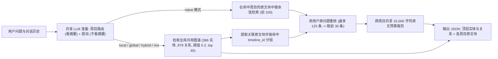

# 为什么这样检索剧情

[English](README.md) | [文档入口](../../README-zh.md) | [模块说明](../../../src/narrative/README-zh.md)

Narrative 负责为 *魔法少女的魔女审判* 检索三个周目 (`1st_Loop`, `2nd_Loop`, `3rd_Loop`) 的游戏正史剧情, 目标是在不混淆不同周目事件, 也不把对话记忆和游戏正史混在一起的前提下提供精确原文. 当前方案是近一年检索实验, 侧车重构, 召回链路排查与语料重建之后的结果.

## 从原生 RAG 到 SQLite + 全库共用图谱的演进

| 阶段 | 当时架构 | 暴露出的问题 | 后续调整 |
| --- | --- | --- | --- |
| 2025 年末 - 2026 年初 | 纯原生 chunk 切块 + 向量检索; 后改为每章加 `progress` 进度条并按早中晚做分数映射 (如早期 `0-0.4`, 晚期 `>0.7`) | 不同周目与阶段事件混杂; 早期 LightRAG 按 Token 滑动窗口切分并在截断处独立 decode, 切开多字节 UTF-8 中文导致 `U+FFFD` 乱码 (更早期的具体调参公式因年代久远已不可考) | 2025 年 12 月小规模对比整部小说, 分周目, 分章节构建后, 先保留分周目 LightRAG 建库 |
| 2026 年 3 - 4 月 (`EmaAgent-Python-Prototype` v0.4 - v0.4.1) | 独立 `narrative` 模式 (`NarrativeMemory`), 单次 `Router` 读 `STORY_SUMMARY_PROMPT` 输出各周目子查询, 3 份独立 LightRAG 目录执行 `batch_query(hybrid, top_k=40, only_need_context=True)` | 无关附件 `ChunkRAG` 干扰剧情问答; `STORY_SUMMARY_PROMPT` 摘要覆盖很少 | `v0.4.1` 在剧情模式下跳过附件 `ChunkRAG` |
| 2026 年 5 - 9 月 (`EmaAgent` TS 重构 + Python 桥接) | TS 服务端通过 `narrative-bridge` 子进程与 Git LFS 数据对接, 并重写 `bridges/narrative` 侧车与 JSON-RPC 生命周期 | 剧情与个人 `Memory` 重复注入; 被动模式挂载浪费上下文; 桌面端打包与监管 Python + LightRAG 侧车复杂度高 | 6 月将 Narrative 与 `Memory` 彻底拆分; 7 - 8 月改为 Agent 主动调用的 `NarrativeSearchTool`; 10 月移除 Python 桥接 |
| 2026 年 10 月 (纯 TS + SQLite) | 迁入本地 SQLite (`narrative.db`), `1024` 维 `bge-m3` Float32 BLOB (`4096` 字节), TS 实现余弦匹配 (`0.2`, `top_k=40`), `narrative-rerank` 与 `isWitchTrialCharacter` 门控 | 路由与改写合并导致范围漂移 (`坠落后` -> `坠落前`) 并从摘要泄露未问及的凶手词; 重排前每轮只截前 20 个 chunk 丢掉关键供述 (`loop1-027` #23, `loop2-024` #31/#46), 尽管全候选池检出曾达 `95/100` | 将周目路由与 LightRAG 提词拆成两次并发 LLM 调用, Rerank 改回用户原问题, 上限放宽到 `125` / `30` / `32,000` 字符 |
| 2026 年 11 月 (语料重建 + 全库共用图谱) | 11 月上旬人工重建语料与链路排查 (`2026-11-03` - `11-07`), 并在 [003_narrativeSchema.sql](../../../src/storage/migrations/narrative/003_narrativeSchema.sql) 与 `004_narrativeData.sql` 落地 | 自动抽取把昵称与第一人称拆成孤立实体 (`小蕾`, `大叔`, `吾辈`) 并把早期谎言当矛盾; 全章 LLM 自动重写会新增归因错误; `RELATED_CHUNK_NUMBER=5` 在重排前就淘汰了块 133; 纯扁平原文返回丢失人工整理图描述 | 整理为 `785` 条保留 `timeline_id` 的高密度清洁块 + `1` 套全库共用图谱 (`386` 个实体, `879` 条关系), Tool 以 JSON 同时返回顶层图描述与按周目分组的 `chunks` |

### 为什么早期 LightRAG 按 Token 分块会出现中文乱码

LightRAG 默认的 `chunking_by_token_size` (`lightrag/chunker/token_size.py`) 先将全文编码为 token 序列, 再按固定 `[start:end]` 窗口切片, 并直接对切片调用 `tokenizer.decode(...)` 还原文本. 字节级 BPE 词表会把未整字收入词表的多字节 UTF-8 中文字符拆成跨 token 的字节片段; 当窗口边界恰好落在某个多字节字符中间并单独解码时, 首尾不完整的 UTF-8 字节序列就会变成 `U+FFFD` 替代符 (乱码). 后来脱离 token 窗口切片并按原始记录重整语料后, 这类乱码消除.

## 为什么改用纯 TypeScript, SQLite 与角色门控

在桌面应用中附带 Python `narrative-bridge` 侧车, Git LFS 索引文件, 端口探测与 JSON-RPC 进程保活, 会把 Python 运行环境与进程管理风险直接带入端侧安装包. 将 `chunks`, `entities`, `relations`, 关联表与 `bge-m3` 向量统一落入 SQLite, 并用 TypeScript 直接完成余弦匹配与重排后, 应用不再依赖 Python 运行时.

同时保留 `isWitchTrialCharacter` 门控, 确保非 *魔女审判* 角色或通用对话场景不会引入剧情检索工具和上下文开销.

## 为什么保留提问意图, 并拆开周目判断与提词

`2026-10-24` 的 `collection-20261024-01` 与 `query-preparation-20261024-01` 排查 (整理于 `2026-10-30`) 定位到单次查询准备中的两类问题:

- **合并提示导致语义漂移**: 让同一个 LLM 请求既读取全局剧情摘要判断周目, 又改写子查询时, 会改动用户原意 (如把 "坠落后" 改写为 "坠落前"), 或把摘要里存在但用户并未询问的凶手名称带入检索词.
- **重排前按周目截断 20 条**: 全候选池在测试中曾达到 `95/100` 的检出, 但进入重排前若只取每轮前 20 个 chunk, 会把 `loop1-027` #23, `loop2-024` #31/#46 这类关键自白提前丢掉.

因此当前实现采用了以下边界 (常量定义见 [constants.ts](../../../src/narrative/pipeline/constants.ts)):

1. **两次并发 LLM 调用**: 周目路由读取剧情摘要判断 `timeline_id`; LightRAG 提词 (`top_level` / `low_level`) 只读用户问题与历史对话, 不看剧情摘要.
2. **原问题重排与放宽容量**: Rerank 直接使用用户原始问题而非提取后的关键词. 候选上限提高到 `RERANK_CANDIDATE_LIMIT = 125`, 保留上限 `RERANK_TOP_K = 30`, `naive` 模式向量候选 `VECTOR_CHUNK_TOP_K = 100`, 原文预算放宽到 `MAX_CHUNK_CHARACTERS = 32,000`.

## 为什么人工重整语料并改为全库共用图谱

`2026-11-03` 至 `2026-11-07` 的对比与逐块排查表明, 自动化图谱抽取和整章 LLM 改写都无法替代对原始台词与事实关系的精修:

- **自动抽取 vs 人工精修**: LightRAG 自动抽取会把角色昵称与第一人称拆成不同节点 (`小蕾`, `大叔`, `吾辈`), 也会把角色早期撒谎或比喻揉成矛盾事实. 尝试用 LLM 对整章图谱做自动重写 (`graphReview-20261104-01`) 后, 虽然修掉了一部分冲突, 但引入了新的归因错误 (例如在 3 处把 "诺亚并不弱小" 错误归到安安身上).
- **上游配额与 Rerank 的能力边界**: 召回链路追踪 (`retrievalTrace-20261104-01`, `chapterRerank-20261104-01`) 分清了两类问题: 块 137 原本排在第 20 位并在预算截断时丢失, 开启 `Qwen3-Reranker-0.6B` 后跃升第 1 位; 但块 133 因上游 `RELATED_CHUNK_NUMBER = 5` (7 个候选槽位) 与关系 token 截断, 在第 53/139 位就被淘汰, 根本没进入重排阶段. 这说明上游未收集到的证据, 重排无法挽回.
- **后置说话人归因敏感性**: 在控制变量诊断 (`chapterPilot-20261104-01`) 中, 小说式后置标注对话 (`"..." 玛格轻声的自言自语`) 即便在块 135 原文完整送达的情况下仍出现两次说话人判断错误, 而在该诊断块前缀加上 `玛格: ` 后误判消失. 但在后续全库终版清洗中, 我们否决了批量人工加前缀的做法.
- **人工重建与 `v4/unified` 清洗**: 第一轮重建 (`fullNarrative-20261104-01` / `final-bank-20261105-01`) 将 31,405 条 Output 记录重整为 1,107 个原文块, 449 个分周目实体和 879 条关系 (原文保留谎言与内心独白, 仅人工精修 110 个实体和 46 条关系). 在 100 题保存关键词的 `mix` 评测 (top-20 重排, 30k token 预算) 中, 原文充足 97 题, 图谱补足 1 题, 不足 2 题 (`cross-002`, `cross-008`), 标定引文命中从 `87/100` 升至 `90/100`. 随后 `2026-11-06` 审校发现 11-04 块中混入了私加的旁白框, 思想前缀 (`艾玛心想:`), 多余引号与导语; 逐段核对清理并按约 1,200 字符紧致打包后, 导出 `v4/unified` 与生产库 (`003_narrativeSchema.sql` / `004_narrativeData.sql`): **785 个保留 `timeline_id` 的清洁原文块** (平均 `1,184.9` 字符, 含 3 个跨周目块), 以及 **1 套全库共用的 386 实体 / 879 关系图谱**.
- **返回结构与预算隔离**: `2026-11-05` 与 `2026-11-12` 更新后, `NarrativeSearch` 以 JSON 同时返回顶层人工精修 `entities` / `relations` 与按 `timeline_id` 分组的 `chunks`. `32,000` 字符预算只限制 `chunks`, 不裁掉顶层图描述.

## 目前接受的限制

- **共用图谱带来的跨周目描述可见性**: 由于 `entities` 和 `relations` 是全库共用而非按周目隔离, 图检索模式 (`local` / `global` / `hybrid` / `mix`) 在回答单周目问题时, 顶层实体与关系描述中可能出现后续周目才揭晓的结果. 当前通过提示词约束模型核对每个原文块的 `timeline_id`, 并区分人物当下宣称与全篇结局.
- **`v4/unified` 100 题测试的边界**: 在 `v4/unified/questionReview100.json` 的纯块评测 (已知周目 + 向量余弦前 100 + `Qwen/Qwen3-Reranker-8B` 前 30) 中, `96/100` 题命中全部预期原文范围 (`163/169`), `97/100` 题命中全部标定引文 (`164/169`), 未解析范围为 `0`. 该轮测试未覆盖合并后 386 实体图谱上的实际 LLM 路由与图向量端到端召回.
- **单次调用的周目路由与共享预算**: 周目选择仍依赖 LLM 基于剧情摘要的判断; 单次查询返回的多个周目共同竞争同一个 `32,000` 字符原文预算 (顶层图描述不受该预算截断).
- **保留原始台词视角**: 清洁原文块刻意保留人物早期谎言, 心理描写与原本的小说式后置归因, 不插入全知旁白前缀, 因此调用方仍需结合上下文辨别说话人和叙述视角.
