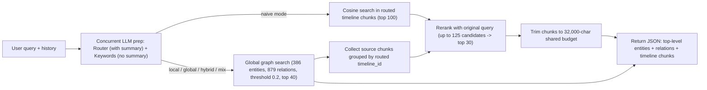

# Why story retrieval works this way

[中文](README-zh.md) | [Documentation](../../README.md) | [Module Reference](../../../src/narrative/README.md)

Narrative retrieves canon plot from *Magical Girl Witch Trial* across three playthroughs (`1st_Loop`, `2nd_Loop`, `3rd_Loop`) without confusing events from different timelines or mixing canon game story into personal conversation memory. Its current design is the result of roughly a year of retrieval experiments, sidecar refactors, failure-trace diagnostics, and manual corpus rebuilds.

## Evolution from raw RAG to SQLite + global graph

| Stage | Architecture | Problem uncovered | Resulting change |
| --- | --- | --- | --- |
| Late 2025 - early 2026 | Plain chunk splitting + vector retrieval, then early/mid/late chapter `progress` score mapping (such as early `0-0.4`, late `>0.7`) | Recurring events across loops collided; earlier LightRAG token-window chunking split multi-byte UTF-8 Chinese characters and produced `U+FFFD` garbling (exact early tuning formulas are no longer preserved) | Evaluated LightRAG in Dec 2025 across whole-story, per-playthrough, and per-chapter splits, then kept per-playthrough LightRAG indexing |
| Mar - Apr 2026 (`EmaAgent-Python-Prototype` v0.4 - v0.4.1) | Separate `narrative` mode (`NarrativeMemory`), 1-shot `Router` over `STORY_SUMMARY_PROMPT`, 3 LightRAG directories queried via `batch_query(hybrid, top_k=40, only_need_context=True)` | Unrelated attachment `ChunkRAG` interfered with story mode; `STORY_SUMMARY_PROMPT` had minimal timeline coverage | Skipped attachment `ChunkRAG` in `narrative` mode (`v0.4.1`) |
| May - Sep 2026 (`EmaAgent` TS + Python bridge) | TS server calling Python `narrative-bridge` subprocess with Git LFS data and `bridges/narrative` sidecar lifecycle | Story overlapped with personal `Memory`, passive mode injection wasted context, and shipping Python + LightRAG in a desktop app added process/deployment burden | Split Narrative out of `Memory` (Jun 2026), moved to agentic `NarrativeSearchTool` (Jul-Aug 2026), then removed the Python bridge (Oct 2026) |
| Oct 2026 (Pure TS + SQLite) | Local SQLite DB (`narrative.db`), `1024`-dim `bge-m3` Float32 BLOBs (`4096` bytes), TS cosine matching (`0.2`, `top_k=40`), `narrative-rerank`, `isWitchTrialCharacter` gate | Combined routing+rewriting altered time scopes (`坠落后` -> `坠落前`) and leaked unasked culprit names; capping 20 chunks per loop dropped confessions (`loop1-027` #23, `loop2-024` #31/#46) even though full candidate pools hit `95/100` | Split timeline routing and LightRAG keyword extraction into 2 concurrent LLM calls, pass the original query to Rerank, and raise limits to `125` / `30` / `32,000` chars |
| Nov 2026 (Corpus rebuild + unified global graph) | Manual Output rebuilds + trace diagnostics (`2026-11-03` - `11-07`) shipped in [003_narrativeSchema.sql](../../../src/storage/migrations/narrative/003_narrativeSchema.sql) and `004_narrativeData.sql` | Automated extraction split pronouns/nicknames (`小蕾`, `大叔`, `吾辈`) and flagged early lies as contradictions; automated LLM rewrites added misattributions; `RELATED_CHUNK_NUMBER=5` pruned block 133 upstream before Rerank; flattened chunk text hid curated graph structure | Rebuilt `785` clean high-density chunks with `timeline_id` + `1` shared global graph (`386` entities, `879` relations), and returned top-level `entities` and `relations` alongside `timeline_id`-grouped `chunks` as JSON |

### Why early token chunking produced garbled text

In LightRAG's `chunking_by_token_size` (`lightrag/chunker/token_size.py`), text is encoded with a tokenizer, sliced into fixed `[start:end]` token windows, and reconstructed by calling `tokenizer.decode(...)` on each window independently. Because byte-level BPE encoders can split a multi-byte UTF-8 Chinese character across adjacent tokens, decoding a sliced token window whose boundary falls inside a multi-byte sequence produces Unicode replacement characters (`U+FFFD`) at chunk edges. Rebuilding chunks cleanly in characters/records eliminated that corruption.

## Why we moved to pure TypeScript, SQLite, and a character gate

Bundling a Python `narrative-bridge` sidecar with Git LFS assets, port probing, and JSON-RPC lifecycle management created installation and startup fragility on end-user desktops. Moving all storage (`chunks`, `entities`, `relations`, link tables, and `bge-m3` Float32 embeddings) into SQLite and running cosine selection + Rerank in TypeScript removed the Python runtime dependency completely.

We kept the `isWitchTrialCharacter` gate so non-canon roles and general assistant sessions do not load story-search prompts or carry story-retrieval overhead.

## Why we preserve intent and split routing from keyword extraction

Diagnostics on `2026-10-24` (`collection-20261024-01` and `query-preparation-20261024-01`, documented `2026-10-30`) uncovered two separate failures in single-call query preparation:

- **Summary-driven semantic drift**: Asking one LLM call to use a global story summary while also rewriting the sub-query altered user conditions (such as turning "after falling" into "before falling") or injected unasked culprit names into search queries.
- **Pre-rerank loop truncation**: Cutting each loop to its top 20 chunks before reranking dropped crucial passages such as confessions (`loop1-027` #23, `loop2-024` #31/#46), even though un-truncated candidate pools reached `95/100`.

To fix both without giving up loop classification:

1. **Two concurrent query-preparation calls**: Timeline routing sees the story summary so it can pick relevant `timeline_id`s, while LightRAG-style keyword extraction (`top_level` / `low_level` keywords) receives only the user's question and history without the summary.
2. **Original query for Rerank + wider limits**: Rerank scores passages against the user's original question rather than extracted keywords. Pre-rerank candidates increased to `RERANK_CANDIDATE_LIMIT = 125`, final kept chunks to `RERANK_TOP_K = 30`, vector-only candidates to `VECTOR_CHUNK_TOP_K = 100`, and returned chunk budget to `MAX_CHUNK_CHARACTERS = 32,000` (defined in [constants.ts](../../../src/narrative/pipeline/constants.ts)).

## Why we rebuilt the corpus and chose a global graph + timeline chunks

Between `2026-11-03` and `2026-11-07`, controlled chapter and full-corpus experiments showed that neither automated LLM graph extraction nor automated LLM corpus rewriting solved precision problems on multi-loop mystery dialogue:

- **Automated graph extraction vs. manual curation**: LightRAG's automated extractor split nicknames and first-person pronouns into separate entities (`小蕾`, `大叔`, `吾辈`) and merged characters' early lies or metaphors as factual contradictions. Running a whole-chapter automated LLM graph rewrite (`graphReview-20261104-01`) resolved some contradictions, but introduced new misattributions (including attributing "诺亚并不弱小" to 安安 in 3 places).
- **Upstream quota vs. Rerank reachability**: Retrieval trace analysis (`retrievalTrace-20261104-01`, `chapterRerank-20261104-01`) confirmed two distinct bottlenecks. When block 137 landed at candidate rank #20 and got dropped by token truncation, enabling `Qwen3-Reranker-0.6B` pushed it to #1. Conversely, block 133 was eliminated upstream at #53 of 139 by `RELATED_CHUNK_NUMBER = 5` (7 candidate slots) and relation token truncation before Rerank ran at all, proving Rerank cannot rescue evidence that upstream quotas never collect.
- **Post-attributed dialogue sensitivity**: In a controlled diagnostic (`chapterPilot-20261104-01`), novel-style post-attributed lines (`"..." 玛格轻声的自言自语`) led to two speaker misattributions even when chunk 135 was returned verbatim; prepending `玛格: ` fixed that diagnostic case, though wholesale synthetic speaker prefixes were avoided in final cleanup.
- **Manual rebuild and `v4/unified` cleanup**: Rebuilding 31,405 raw Output records first into 1,107 chunks (with 449 per-loop entities and 879 relations, manually curating 110 entities and 46 relations while keeping lies and inner monologue intact in source chunks) raised marked-quote hits on a 100-question saved-keyword `mix` run (top-20 rerank, 30k-token cap) from `87/100` to `90/100` (97 source-sufficient, 1 graph-supplemented, 2 insufficient: `cross-002`, `cross-008`). Auditing that 11-04 build caught unauthorized frame/thought prefixes (such as `艾玛心想:`), extra quotes, and intro summaries. Cleaning those artifacts and packing contiguous text near ~1,200 characters yielded **785 chunks** (average `1,184.9` characters, including 3 cross-loop chunks) with `timeline_id` preserved per chunk, paired with **one unified global graph of 386 unique entities and 879 relations**.
- **Output format & budget split**: In `2026-11-05` and `2026-11-12` (`003_narrativeSchema.sql` / `004_narrativeData.sql`), `NarrativeSearch` changed to return top-level curated `entities` and `relations` alongside `timeline_id`-grouped `chunks` as JSON. The `MAX_CHUNK_CHARACTERS = 32,000` budget truncates `chunks` across the selected timelines so graph descriptions are not silently dropped.

## Limitations we currently accept

- **Cross-loop descriptions in the global graph**: Because `entities` and `relations` live in a single story-wide graph rather than three separate per-loop graphs, graph queries on single-loop questions can still return entity or relation summaries that mention outcomes from other loops. Tool prompts and instructions tell the Agent to check each chunk's `timeline_id` and separate character claims from final plot outcomes.
- **Partial 100-question coverage on `v4/unified`**: In the `v4/unified/questionReview100.json` evaluation (chunk-only cosine top-100 + `Qwen/Qwen3-Reranker-8B` top-30 with known timelines), `96/100` questions returned all expected source ranges (`163/169`) and `97/100` matched all marked quotes (`164/169`), with `0` unresolved ranges. That run did not test live LLM timeline routing or graph-vector retrieval over the merged 386-entity graph.
- **Single-call timeline budget & router dependency**: Timeline selection still depends on LLM classification against the story summary, and the `32,000`-character chunk budget is shared across all loops returned in a single tool call.
- **Faithful in-character perspective**: Source chunks retain character lies, inner thoughts, and original literary attribution rather than inserting omniscient summaries or synthetic narrator prefixes, so callers must still interpret speaker perspective from passage context.
