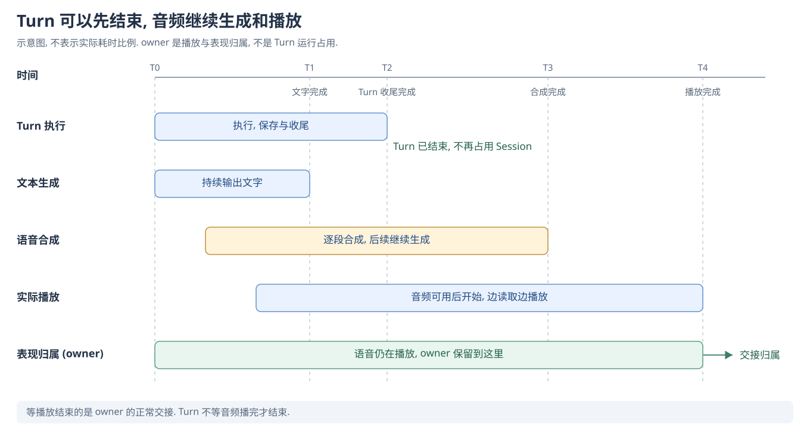
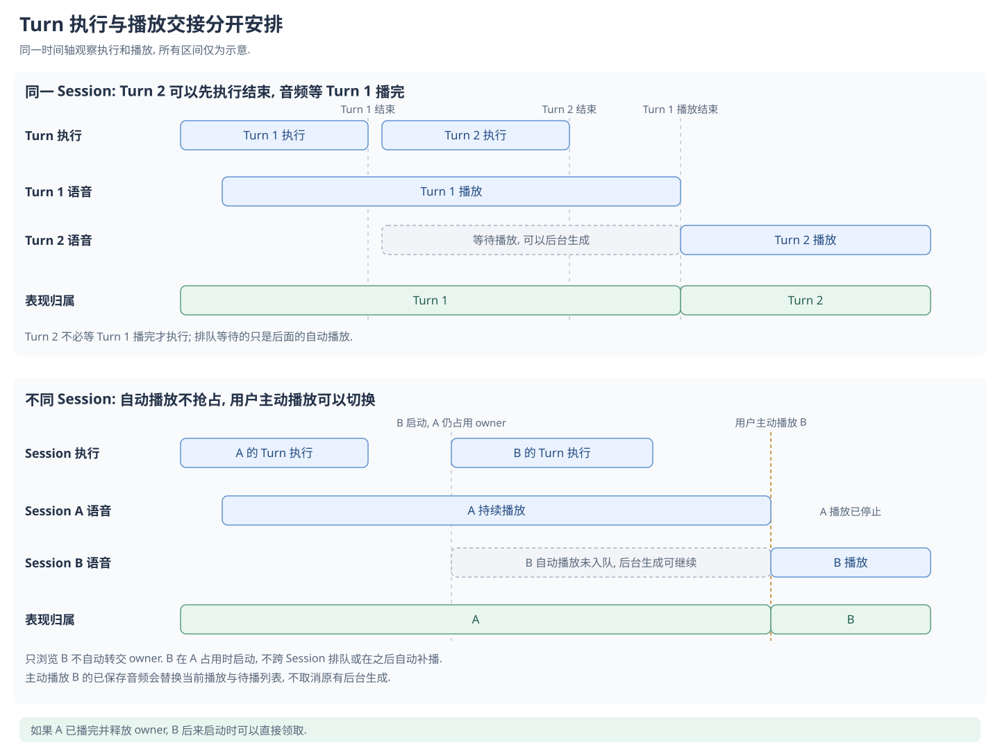

# 为什么把语音生成, 播放与声音版本分开

[English](README.md) | [文档入口](../../README-zh.md)

语音既用于当前角色说话, 也可以作为已完成回复的保存结果, 供用户重播或用其他角色的声音重新生成. 我们希望这些使用方式不必依赖重新请求一次 LLM.

## 为什么生成和播放各自推进

一般情况下, 语音合成和实际播放的进度会落后于文本生成. 文字已经出来, 不代表音频已经全部合成; 音频合成完成, 也不代表用户已经听完.

我们选择逐段生成, 有可用音频后先播放, 后续音频继续生成. 不必等整轮音频完成才开始收听. 停止播放也不默认取消后台生成, 用户可以先不听, 保留之后重播的结果.

代价是这三个进度可能不同步. 有时用户能看到后面的文字, 却还在听前面的内容. 我们接受当前的差异, 不把生成完成和播放完成合成一个结束时刻.

**Turn 不等待音频播完才结束.** 它完成执行, 保存和收尾后即可结束; 音频仍可继续生成或播放. 等待播放结束的是 owner 的正常交接, 不是 Turn 的结束.

图示只解释启用语音时的结束边界, 不表示实际耗时比例. 取消和播放失败还可以提前释放表现归属.

## 为什么需要领取表现归属

Stage 只有一个当前说话的位置. 如果多轮内容同时改变气泡, 表情, 动作和口型, 用户可能听到一轮的声音, 却看到另一轮的表现.

因此我们给当前驱动这套表现的 Turn 一个明确归属, 代码中称为 owner. 当前 owner 决定正在展示的内容, 其他 Turn 的事件不能随意混进来. 有音频时, 正常交接要等实际播放结束, 不能在收到语音生成完成时提前交出.

我们接受后面的语音可能等待, 也不让不同 Session 同时争抢同一个 Stage. 这限制了并行表现, 但使当前听到和看到的内容有明确来源. 没有领取播放归属, 不代表后台语音不能继续生成.

## 连续 Turn 与 Session 切换的例图

下面直接对比同一 Session 连续两轮, 以及 A 播放时启动 B 后主动切换播放的情况. 图中 Turn 均启用 TTS; 纯文字 Turn 不加入待播队列.

例图只表示先后关系, 不表示实际耗时. 播放 owner 不阻止其他 Session 的 Turn 执行.

## 为什么 Chat 和 data 页都提供生成入口

Chat 里的播放用于再次收听已保存的音频. 重新生成则允许用户在合成失败, 更换参考声音或调整配置后, 对同一轮正文再次合成. 用户不需要为了重新生成声音而改动已经满意的回复, 或再请求一次 LLM.

data 页把同一轮保存的声音放在一起. 用户可以从有可用参考声音的角色中选择, 为已有文本生成该角色的音频. 这样能补生成, 比较和保留不同角色的声音版本. 当前是由用户选择角色生成, 不是自动一次生成全部角色.

data 页生成后不自动播放, 普通试听也不驱动 Stage 口型. 管理和比较声音不必同时接管聊天表现. 手动重新生成失败或取消时保留原有音频, 避免一次未完成的尝试破坏已有结果.

代价是需要管理同一段文字的多个角色音频, 每次重新生成也会产生实际 TTS 请求和相应费用. 我们选择让用户分别决定是否重播和是否重新生成.

## 当前不增加等待语音的模型阻塞

另一种可选策略是增加等待, 让后续模型执行等到语音合成和实际播放完成后再推进. 这可能让文字和声音的节奏更接近, 但也会让模型执行受到语音与用户收听速度的影响.

当前 B 测不增加这段额外的 await 等待. 如果用户对节奏差异的反馈较多, 再重新评估等待策略及其适用场景. 这是尚未采用的选项, 不是当前已经提供的同步模式.

生成和音频保存的约定见 [Speech](../../../src/speech/README-zh.md), 供应商调用见 [TTS](../../../src/tts/README-zh.md).
