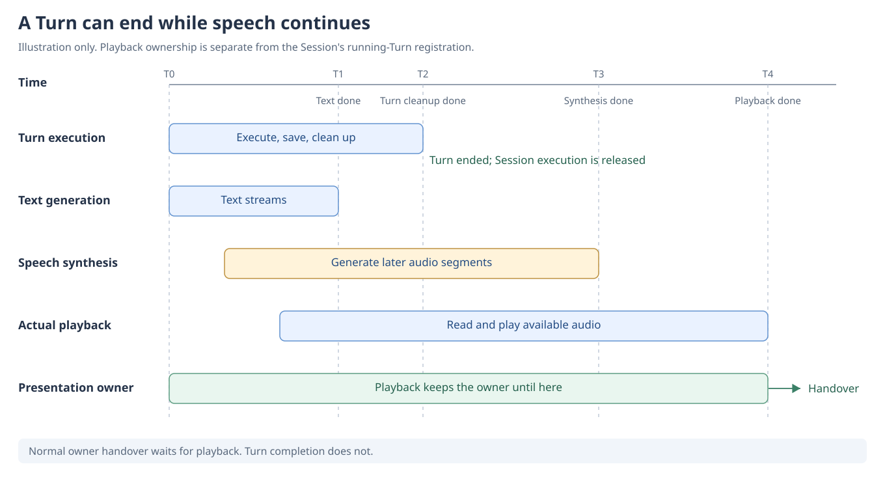
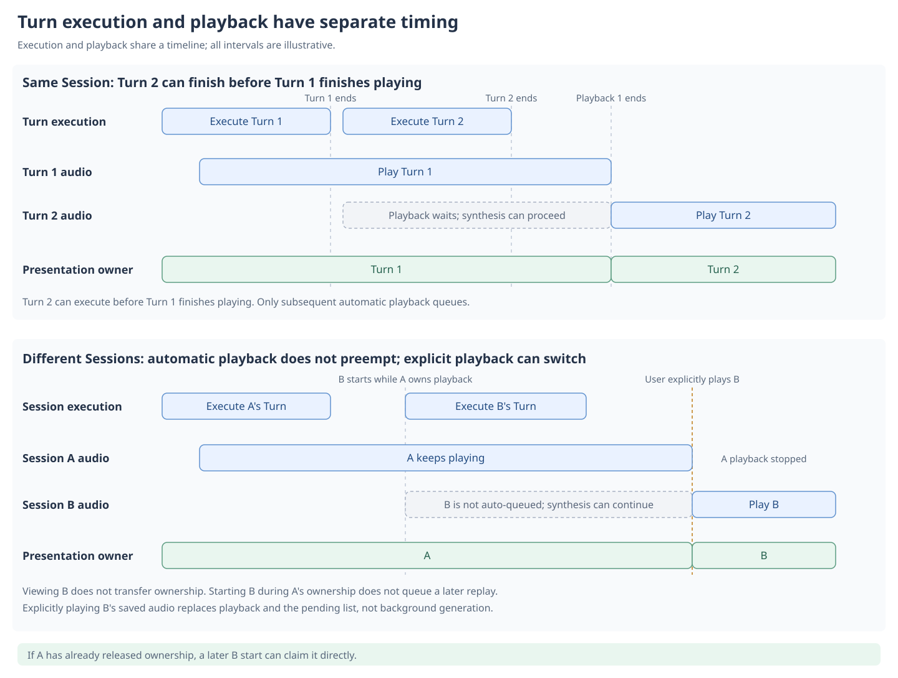

# Why speech generation, playback, and voice versions are separate

[中文](README-zh.md) | [Documentation](../../README.md)

Speech lets the current character speak and provides a saved result that can be replayed or regenerated with another character's voice. We want these uses to work without requesting another LLM reply.

## Why generation and playback progress independently

Speech synthesis and actual playback generally progress behind text generation. Having the text does not mean all audio has been synthesized; finishing synthesis does not mean the user has finished listening.

We generate in segments, start playback when audio is available, and keep generating subsequent audio. Listening can begin before the complete reply's audio is ready. Stopping playback does not cancel background generation by default: the user can stop listening while keeping the result for later replay.

The accepted cost is that these three forms of progress can differ. The user may see later text while hearing earlier content. We accept that difference for now rather than treat generation completion and playback completion as one ending.

**A Turn does not wait for playback to finish before ending.** It can end after execution, saving, and cleanup while audio continues generating or playing. Normal owner handover waits for playback; Turn completion does not.

This illustration explains ending boundaries with speech enabled, not measured duration ratios. Cancellation or playback failure can release presentation ownership earlier.

## Why presentation ownership is claimed

The Stage has one current speaking position. If several Turns change its bubble, expression, motion, and mouth at once, the user can hear one Turn while seeing another's presentation.

We give the Turn currently driving that presentation explicit ownership, called owner in code. The current owner determines what is presented, and events from other Turns cannot freely mix into it. With audio, a normal handover waits for actual playback to end instead of happening as soon as synthesis finishes.

We accept that later speech may wait and do not let different Sessions compete for the same Stage simultaneously. This limits parallel presentation while making the source of visible and audible content clear. Not owning playback does not prevent background speech generation.

## Consecutive Turns and Session changes, illustrated

The examples compare two consecutive Turns in one Session with starting B during A's playback and explicitly switching playback. The Turns shown have TTS enabled; text-only Turns do not enter the playback queue.

The diagrams show ordering, not measured durations. Playback ownership does not prevent another Session's Turn from executing.

## Why both Chat and the data page can generate speech

Chat playback lets the user hear saved audio again. Regeneration synthesizes the same Turn's text after a synthesis failure, a reference-voice change, or a configuration adjustment. The user does not need to change a satisfactory reply or request another LLM answer just to obtain another audio result.

The data page groups saved voices for the same Turn. The user can choose a character with a usable reference voice to generate audio from the existing text. This supports later generation, comparison, and retaining different character voice versions. It is a user-selected character operation, not automatic generation for every character at once.

Generation on the data page does not automatically play the result, and ordinary preview does not drive Stage mouth movement. Managing and comparing voices need not take over the chat presentation. Failed or cancelled manual regeneration preserves existing audio so an incomplete attempt does not destroy a usable result.

The cost is managing several character audio versions of the same text. Each regeneration also makes real TTS requests and can incur charges. We let the user decide separately whether to replay or regenerate.

## Why the beta does not add a model wait for speech

An alternative is to make later model execution await synthesis and actual playback. This could bring visible and audible progress closer together, but would also tie model execution to synthesis and listening speed.

The current beta does not add that extra await. If users frequently report pacing problems, we will reassess whether waiting is appropriate and where it should apply. This is an option to evaluate, not an implemented synchronization mode.

Generation and audio-saving contracts are in [Speech](../../../src/speech/README.md); provider calls are in [TTS](../../../src/tts/README.md).
