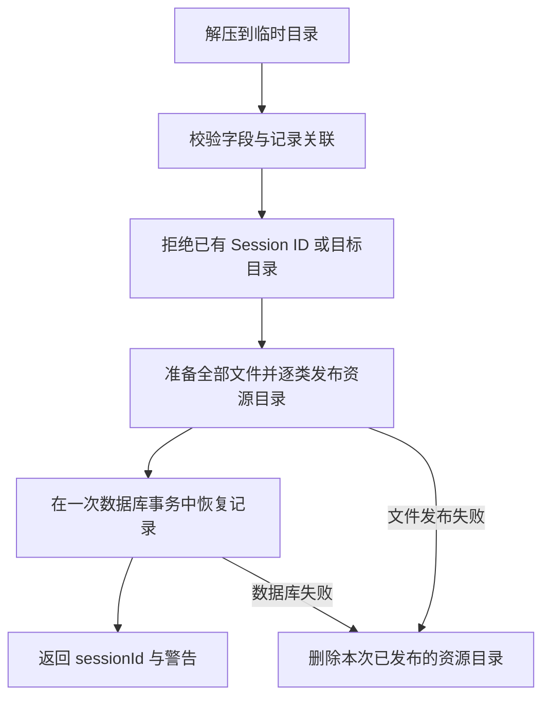

# Backup

[English](./README.md)

Backup 把单个 Session 导出或导入为 `.ema-session.zip`. 它同时处理数据库记录及各资源目录下属于该 Session 的文件, 仅复制资源文件不能保留完整消息.

## 使用

```ts
const backup = new SessionBackup(
  activeDataDir,
  sessionBackupReader,
  sessionBackupRestorer,
  modelSelectionExists,
);

const exported = await backup.exportSession(sessionId, destinationPath, signal);
const imported = await backup.importSession(zipFilePath, signal);
```

每个数据目录只创建一个实例. 构造时清空该目录的 `.backup-temp`, 包括上次操作中断留下的文件. 路径属于运行 Server 的本机, HTTP 入口要求绝对路径.

归档包含:

- `manifest.json`: Session ID, 导出时未包含的资源, 下载文件和工具大文本的来源路径, 包内路径, 大小与修改时间.
- `records/session.json` 和 JSONL 文件: Session, Turn, Message, Task, Goal, 子代理身份/Run/消息, 工具执行, 后台进程, 附件, 语音和用量.
- `files/`: 受管附件, 已记录的 WAV, 后台进程输出, WebFetch 下载和导出时仍存在的工具大文本. 外部文件引用仍为原路径. 不包含临时便签及未完成下载.

资源从 `<activeDataDir>/<resourceKind>/<sessionId>/` 收集, 音频进一步按 Turn 分组, 进程输出按进程 ID 分组. 工具大文本可能已经过期, 缺失不阻止导出会话. 导入保留其修改时间, 不重新开始计算过期时间. 没有 `resourceFiles` 的既有归档仍恢复已记录资源, 不凭空补出未备份的下载文件.

记录必须符合 [sessionRecords.ts](./records/sessionRecords.ts) 的当前字段校验. 归档没有 SQLite 数据库版本, 也不执行数据库迁移. 导入前由 Storage 初始化或迁移目标数据库, 然后向其中写入通过校验的记录. Task, Goal, 工具和进程记录中的 `version` 是更新计数, 不是数据库版本或应用版本. 没有备份版本转换, 必填字段变化后, 以前导出的归档可能无法导入.

## 导出与导入顺序

导出在一次数据库读取事务中取得记录并写入临时目录, 事务结束后再复制受管文件. 缺失或不可读的资源写入 `omittedFiles` 并返回警告, 导出仍可完成. ZIP 先写到所选目标旁边, 完成并关闭后才重命名为目标文件. 失败或取消不会破坏已有备份. 目标的父目录必须已存在.

导入逐个读取磁盘 ZIP 条目并写入临时文件, 检查路径越界, 重名和合计 8 GiB 的展开限制. JSONL 逐块读取, 单行最多 16 MiB, 末行必须有换行. 完成校验的记录仍会先收集成数组, 再恢复数据库.



不合并已有会话, 已有 Session ID 或目标资源目录会产生冲突. 所有文件先在 `.backup-temp` 中准备完整, 再逐类发布. 文件发布和数据库事务是两项操作, 失败时只删除本次已发布的目录; 强制退出留下的无 Session 目录由 Server 启动清理. 当前安装没有原模型选择时清空该选择并返回警告, 历史模型来源仍保留.

导入重写受管图片和粘贴文本引用, 包括 fork 继承消息, 以及 Read 对已恢复文件的精确路径. WebFetch 的下载数据和说明, ToolResultStore 的大文本落盘说明头也同步更新. 不对普通正文, 外部文件引用或任意工具输出进行全局替换.

语音保留 Turn 音频目录下的 `<turnId>-<characterName>.wav` 文件名. 子代理身份, Run, 原始模型来源和摘要游标分别保存. 导入不会重新启动工作: running Turn 变为 aborted, running 子代理身份和 Run 变为 cancelled, active Goal 变为 paused, in_progress Task 变为 pending, 未结束的工具和后台进程改为终态.

## 完成与清理

正常失败或取消会清理临时工作目录和未完成 ZIP. 强制结束进程可能在所选保存位置旁留下 `.ema-session-export-*` 目录; 启动清理只覆盖 `activeDataDir/.backup-temp`.

桌面端使用原生文件对话框, 再通过已认证 HTTP 传递路径:

| 请求 | 输入 | 成功 |
| --- | --- | --- |
| `POST /api/sessions/:sessionId/export` | `{ destinationPath }` | `200 { filePath, warnings }` |
| `POST /api/sessions/import` | `{ filePath }` | `201 { sessionId, warnings }` |

[路由](../../apps/server/src/routes/backup/sessions.ts) 在导入成功后发布 Session 列表变更. 取消文件选择不发请求.

## 阅读与检查

先看 [sessionBackup.ts](./sessionBackup.ts), 再跟进导出和导入流程. `records` 保存归档字段与数据库转换, `import/archive.ts` 处理解压. 测试使用真实 ZIP 和临时或内存 SQLite 检查往返, 失败和清理.

```sh
pnpm --filter @ema-agent/backup test
```

HTTP 测试在 [Server backup tests](../../apps/server/src/routes/backup/tests). 桌面导入和导出控件在 [StorageTab.tsx](../../apps/desktop/src/settings/data/StorageTab.tsx). 原生文件对话框仍需桌面验收.
