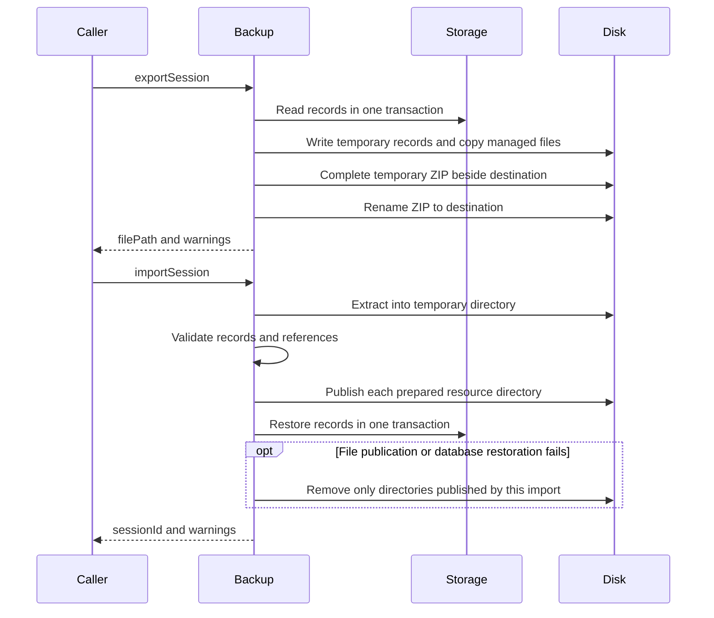

# Backup

[中文](./README-zh.md)

Backup exports and imports one Session as a `.ema-session.zip`. It combines database records with the Session's files from each resource directory. Copying resource files alone does not preserve messages.

## Use

```ts
const backup = new SessionBackup(
  activeDataDir,
  sessionBackupReader,
  sessionBackupRestorer,
  modelSelectionExists,
);

const exported = await backup.exportSession(sessionId, destinationPath, signal);
const imported = await backup.importSession(zipFilePath, signal);
```

Create one instance per active data directory. Construction clears that directory's `.backup-temp`, including files left by interrupted operations. Paths refer to the machine running the Server and must be absolute at the HTTP boundary.

The archive contains:

- `manifest.json`: Session ID, resources omitted during export, and downloaded-file/tool-text entries with their source paths, archive paths, sizes, and modification times.
- `records/session.json` and JSONL files: Session, Turns, messages, Tasks, Goals, subagent identities/Runs/messages, tool executions, background processes, attachments, speech outputs and usage.
- `files/`: managed attachments, recorded WAV files, background-process output, WebFetch downloads, and persisted tool text still present at export. External file references remain paths. Scratchpads and incomplete downloads are excluded.

Resources come from `<activeDataDir>/<resourceKind>/<sessionId>/`; audio is further grouped by Turn and process output by process ID. Tool text may already have expired, so its absence does not prevent exporting the Session. Import preserves its modification time rather than restarting the expiry period. Existing archives without `resourceFiles` restore their recorded resources without inventing missing downloads.

Records must match the current schemas in [sessionRecords.ts](./records/sessionRecords.ts). The archive does not carry a SQLite database version and does not migrate a database. Imports insert validated records into the target database after Storage has initialized or migrated it. Task, Goal, tool, and process `version` fields are update counters, not database or application versions. There is no archive-version conversion. Older exports may stop being importable when required fields change.

## Export and import order



Export copies files after the database read transaction ends. Missing or unreadable resources go into `omittedFiles` and warnings; export can still finish. A failed or cancelled ZIP write preserves an existing destination. The destination's parent directory must already exist.

Import reads ZIP entries from disk and streams them into temporary files, checking path traversal, duplicate names and an 8 GiB total expanded limit. JSONL parsing is incremental, with a 16 MiB line limit, but validated records are collected in arrays before restoration. A final newline is required.

Existing Session IDs or target resource folders cause a conflict; imports are not merged. All files are prepared in `.backup-temp` before their resource directories are published. File publication and the database transaction are separate operations. A failure removes only directories published by this import; Server startup cleans directories without a corresponding Session after a forced exit. Missing model selection is cleared with a warning, while historical model sources remain.

Import rewrites managed image/pasted-text blocks, including inherited fork messages, and exact Read paths for restored files. It also rewrites WebFetch download data/notices and ToolResultStore's persisted-output headers. Ordinary prose, external file references, and arbitrary tool output are not globally substituted.

Speech files retain the `<turnId>-<characterName>.wav` name under the Turn audio directory. Subagent identities, Runs, original generation sources and summary cursors remain distinct. Import does not restart work: running Turns become aborted, running subagents/Runs become cancelled, active Goals become paused, in-progress Tasks become pending, and unfinished tools/processes receive terminal states.

## Completion and cleanup

Normal failures and cancellation remove temporary working directories and unfinished ZIPs. A forced process exit may leave a `.ema-session-export-*` directory beside the chosen destination; startup cleanup only covers `activeDataDir/.backup-temp`.

The desktop uses native file dialogs, then passes paths through authenticated HTTP:

| Request | Body | Success |
| --- | --- | --- |
| `POST /api/sessions/:sessionId/export` | `{ destinationPath }` | `200 { filePath, warnings }` |
| `POST /api/sessions/import` | `{ filePath }` | `201 { sessionId, warnings }` |

The [route](../../apps/server/src/routes/backup/sessions.ts) publishes a Session list change after successful import. Cancelling the file dialog sends no request.

## Reading and checking

Start with [sessionBackup.ts](./sessionBackup.ts), then follow export/import orchestration. The `records` directory holds archive schemas and database mappings; `import/archive.ts` handles extraction. Tests use real ZIP files and temporary/in-memory SQLite databases for round trips, failures and cleanup.

```sh
pnpm --filter @ema-agent/backup test
```

HTTP tests live in [Server backup tests](../../apps/server/src/routes/backup/tests). Desktop import and export controls are in [StorageTab.tsx](../../apps/desktop/src/settings/data/StorageTab.tsx). Native dialogs still need desktop verification.
