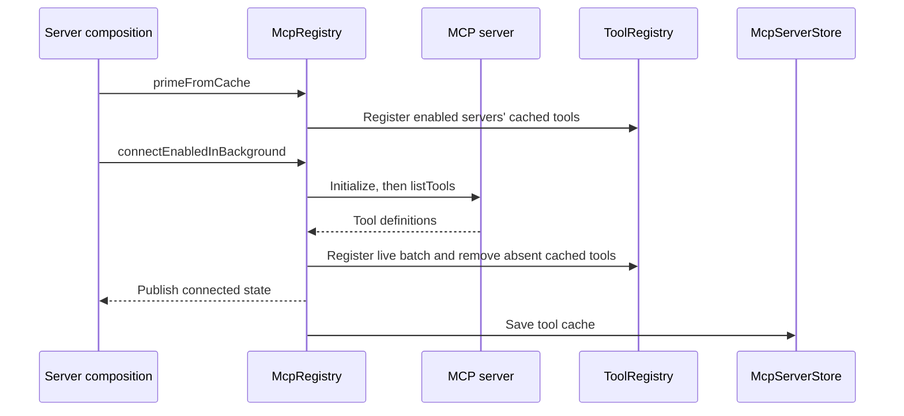

# MCP

[中文](./README-zh.md)

This package connects Ema to MCP servers, turns their tools into Ema tools, saves server settings, and provides the Official MCP Registry market.

## Entry points

- `McpServerStore` reads and writes installed configs and the last successful tool list through `McpServersRepo`.
- `McpRegistry` manages connections and registered tools. Settings routes use `listServers`, `getServer`, `save`, `setEnabled`, `disconnect`, `remove`, and `probe`. Tool execution uses `callTool`.
- `parseImportedMcpServers` accepts a parsed JSON object: an `mcpServers` or `servers` wrapper, a name-to-config map, or a single config. It returns validated stdio or Streamable HTTP configs. SSE configs are rejected rather than guessed into HTTP configs.
- `McpMarketService`, `McpMarketStore`, and `OfficialRegistryAdapter` handle market browsing, refresh, details, and installation.
- `McpLocalCommandEnvironment.inspect` finds `npx`, `uvx`, `bunx`, and Python 3 on the host PATH and reads their versions for settings.

For example, the import route parses user JSON before calling:

```ts
const servers = parseImportedMcpServers({
  mcpServers: {
    fetch: { command: 'uvx', args: ['mcp-server-fetch'] },
  },
});
for (const server of servers) {
  await registry.save(server.name, server.config, { sourceKind: 'import' });
}
```

Saving returns after writing the config and starting a background connection, without waiting for it to become usable.

## Connections and tools

Server composition creates the store and registry, calls `primeFromCache`, then `connectEnabledInBackground`. Cached tools make their descriptions available during startup. Calling one still waits for a live connection and tool discovery.



Client and transport modules load when a connection is needed. Each connection has its own Client. The handshake timeout is 30 seconds, starting after module loading; tool discovery has a separate 15-second timeout. An empty remote tool list is valid, but discovery failure makes the connection fail.

Concurrent requests for the same config share the connection task. Cancelling a tool call ends its wait without cancelling a shared connection task. Disconnecting or replacing a server cancels its connection and refresh tasks. A generation counter prevents late tasks and close callbacks from overwriting newer state.

Tool-list notifications are subscribed before initial discovery and share one refresh loop. A new batch is validated before replacing registered tools. A failed refresh keeps the previous list; a failed cache write keeps the live connection.

Disabling or deleting unregisters tools and cancels retries. A previously connected HTTP server that closes unexpectedly retries after 1, 2, 4, 8, and 16 seconds. An exited stdio process is not restarted automatically. The next direct tool call can attempt a new connection. `probe` always closes its temporary connection without saving settings or registering tools.

## Stored data and model output

`mcp_servers` stores the config, enabled state, installation source, and tool cache. Environment values and HTTP headers are plaintext JSON. `envPassthrough` instead saves names and reads current values from the host when connecting. The merge order is SDK defaults, passthrough values, then explicit `env` values.

`listServers` returns summaries with `toolCount`; SQLite counts cached tools without returning their definitions. `getServer` adds live tools when connected, otherwise the saved cache. Desktop stores summaries globally and requests details when needed. Connection state is process-local.

Remote `readOnlyHint` does not grant permission or allow concurrency. A true `destructiveHint` requires approval. Other calls go through the user's Permission rules and mode. Saving and enabling a local server allows its configured process to start; tool calls still use the normal tool permission flow.

Discovery accepts at most 256 tools and 1 MiB of serialized definitions per server. `callTool` uses the configured timeout or 120 seconds and forwards cancellation to the SDK. Remote `isError` results become `McpToolCallError`.

Output keeps bounded `content` and optional `structuredContent`. Content examines at most 100 incoming blocks, limits encoded binary data to 256 KiB per block, and reserves space within its 1 MiB budget for a truncation notice. Structured content has a separate 1 MiB limit and is dropped whole when oversized. Remote `_meta` is discarded.

`projectMcpToolOutput` passes text through, converts images to `image_data`, adds source URIs to resource text, and appends structured content as JSON text. Audio, non-image binary resources, and unsupported blocks produce explanatory text.

## Market cache and notifications

The Official Registry adapter reads the `v0.1` servers endpoint. `mcp_market_entries` stores list fields by source and external ID; `mcp_market_fetch_state` stores the next upstream cursor. SQL search and pagination return 40 items per page.

- No cache: wait for the first page, save it with its cursor, and fetch the remaining pages in the background.
- Partial cache: return cached results immediately and resume from the saved cursor.
- Complete cache: return immediately and start one background refresh on the first load in this process.
- Full refresh: gather all pages before replacing the source in one transaction. Failure keeps the previous cache. A partial sync keeps pages already saved.

Installation reads current remote details, builds an explicit config, collects required headers or environment values, then saves the server with its Official Registry entry ID.

Config and tool-cache writes emit `mcp_servers_changed`. Connection changes emit `mcp_connection_changed`. Market writes emit `mcp_market_changed` with the source. Server forwards these events so Desktop can read current data again. HTTP shapes come from `apps/server/src/routes/mcp`; Desktop API types are inferred from those routes.

## Reading and verification

Start with `registry.ts` for connections, `discovery.ts` for the Ema tool contract, and `execution.ts` for cancellation and output conversion. `store.ts` handles stored configs; `market/marketService.ts` coordinates cache reads and writes.

Run `pnpm --filter @ema-agent/mcp test`. Tests cover config import, credentials, connection cancellation and closure, discovery limits and permissions, output conversion and limits, and market paging and installation. Storage tests in `src/storage/tests/repos/mcp-market.integration.test.ts` cover market SQL operations. Network tests here use simulated SDK clients and HTTP responses, not a live remote registry.
