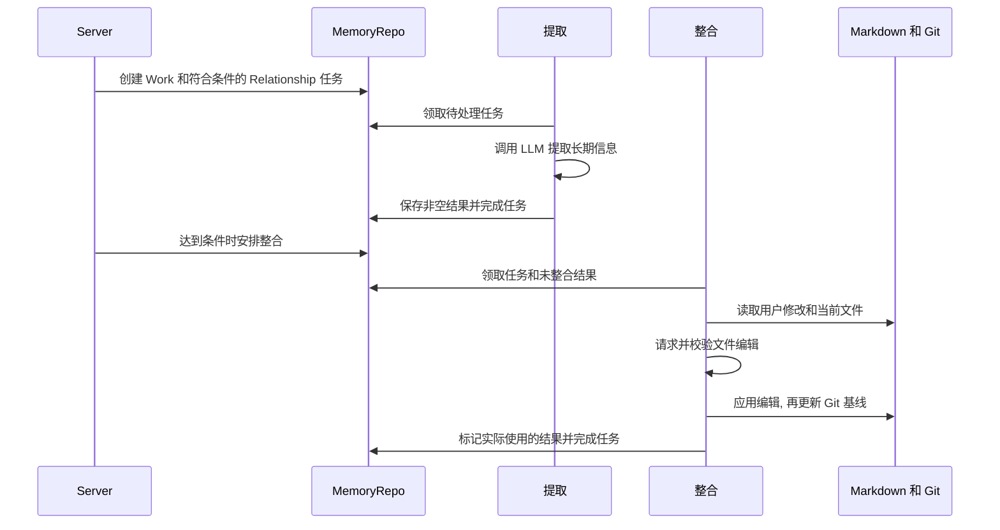

# Memory

[English](./README.md)

Memory 用本地 Markdown 保存长期用户信息. Work 保存稳定工作偏好和协作规则. Relationship 保存共享用户背景, 角色专属偏好, 约定和重要经历. 两轨共用 `memory-llm` 模型绑定, 分别执行提取, 整合和维护任务.

## 文件与 Turn 输入

默认根目录是 `~/.ema-agent/memories`, 设置 `EMA_PROFILE_DIR` 后使用 `<EMA_PROFILE_DIR>/memories`.

```text
memories/
  work/
    MEMORY.md
    memory_summary.md
    topics/*.md
    .git/
  relationship/
    shared_user_memory.md
    character_relations.md
    characters/<character_name>/
      MEMORY.md
      history/*.md
    .git/
```

Turn 准备时, Server 按估算 2,500 Token 预算读取 Work 摘要. Relationship 读取共享用户记忆和当前角色 MEMORY 全文, 以及 `character_relations.md` 标题或正文含该角色名的完整二级标题段落. 缺失或空文件不提供内容. 正文进入 Turn reminder, `MEMORY_GUIDANCE` 另行说明如何使用.

主 Agent 的 MemorySearch, MemoryRead, MemoryList 由 Server 绑定根目录. 搜索采用子串匹配, 可忽略大小写或统一斜杠. `all_within_lines` 从候选行开始检查连续五行. Read 支持从 1 开始的行号和行数限制, 按完整行返回最多估算 20,000 Token. 搜索和列举游标是数字偏移, 文件变化时不能当作稳定位置.

搜索和预览枚举非隐藏 Markdown, 排除注入摘要和生成的 Git diff. List 返回可见的直接子项. Read 检查文件位于根目录内, 同样排除隐藏与内部文件. 概览最多取最近修改的五份非空 Markdown, 每份只读开头 2 KiB, 不拆开 UTF-8 字符.

## 从完成 Turn 到 Markdown



[Server composition](../../apps/server/src/composition/memory.ts) 从完成 Turn 中保留顺序排列的用户和助手文本. 工具调用/结果, 推理, reminder, summary 和附件不进入提取. Relationship 要求角色名. 每轨两个提取 worker.

提取接受 `{}` 或仅包含字符串 `content` 的对象. 空字符串, null 和空数组也视为空内容, 其他形状失败. 空输出只完成任务, 不写提取结果.

未整合结果达到八条, 或最早一条等待六小时后可以整合. 一次最多选取 256 条. 输入按 16 MiB 预算先放完整提取结果, 再按剩余空间放 Git diff 和当前文件. 只有本地记录的 `consumedTurnIds` 会标成已整合.

模型返回带完整正文的 `write` 或 `delete`. Work 可修改 MEMORY.md, memory_summary.md 和单层 topics Markdown. Relationship 可修改两个共享文件, 以及已有或本批提取角色的 MEMORY/history 文件. 应用前检查路径和输出字段.

先顺序修改文件, 再更新 Git 基线, 最后在 SQL 完成整合标记. 文件和 SQL 之间不是同一原子事务, 后续失败不会回滚已写文件. 取消时保留已领取任务供启动恢复, 不记成普通失败.

Server 在 HTTP ready 后启动调度并重新排队中断任务. 每小时检查整合条件, 每 12 小时尝试维护. 同轨整合与维护串行, 两轨互不等待. 关闭时中止模型调用并停止领取新任务. 模型输出上限与用量记录由 Server composition 提供.

## 维护与容量

Work 维护删除临时 diff 并压缩 Git 基线存储. Relationship 还按文件名日期, 为每个角色保留最近 180 个有历史文件的活跃日期, 不是最近 180 个自然日.

占用统计包含 Git 数据和符号链接自身大小. 1 GiB 的 80% 以下为 normal, 从 80% 起 warning, 达到 1 GiB 为 limitExceeded. 这是展示状态, 不自动删除文件或阻止执行.

## 阅读与检查

从 [extractTurn.ts](./extractTurn.ts) 和 `jobs/` 看任务执行. [consolidation.ts](./consolidation/consolidation.ts) 处理模型编辑和输入预算, 各轨文件限定可写位置. [memoryFiles.ts](./common/memoryFiles.ts) 为读取, 搜索, 列举和预览提供内容. [Server Memory 路由](../../apps/server/src/routes/memory) 提供文件, 预览, 任务详情和容量, SQL 任务存储在 [Storage](../storage/README.md).

```sh
pnpm --filter @ema-agent/memory test
```

本地测试覆盖提取形状, 整合路径与输入预算, Git diff, Turn 关系输入, 预览和取消. Storage 与 Server 另有 SQL 任务和实际 HTTP/模型请求处理测试.
