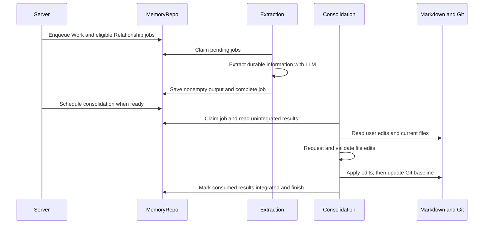

# Memory

[中文](./README-zh.md)

Memory keeps long-term user information in local Markdown. Work stores stable working preferences and collaboration rules. Relationship stores shared user background, character-specific preferences, agreements and meaningful experiences. Both tracks use the `memory-llm` model binding and separate extraction, consolidation and maintenance jobs.

## Files and Turn input

The default root is `~/.ema-agent/memories`, or `<EMA_PROFILE_DIR>/memories`.

```text
memories/
  work/
    MEMORY.md
    memory_summary.md
    topics/*.md
    .git/
  relationship/
    shared_user_memory.md
    character_relations.md
    characters/<character_name>/
      MEMORY.md
      history/*.md
    .git/
```

At Turn preparation, the Server reads the Work summary within its 2,500-token estimate budget. It reads shared user memory and the current character's MEMORY file, plus complete level-two sections in `character_relations.md` whose heading or body contains that character name. Missing/empty files contribute nothing. These texts enter the Turn reminder; `MEMORY_GUIDANCE` separately explains how to use them.

The main Agent's MemorySearch, MemoryRead and MemoryList tools use functions bound to this root by the Server. Search uses literal substrings, optionally case-insensitive or slash-normalized. `all_within_lines` checks five consecutive lines starting at each candidate line. Read supports one-based offsets and line limits, returning whole lines up to an estimated 20,000 tokens. Search/list cursors are numeric offsets, not stable positions if files change between requests.

Search and previews enumerate nonhidden Markdown, excluding the injected summary and generated Git diff. List returns visible immediate children. Read resolves a requested file within the root and applies the same hidden/internal exclusions. The overview takes up to five recently modified nonempty Markdown files and reads at most 2 KiB from each, without splitting a UTF-8 character.

## From completed Turn to Markdown



[Server composition](../../apps/server/src/composition/memory.ts) projects ordered user/assistant text from completed Turns. Tool calls/results, reasoning, reminders, summaries and attachments are omitted. Relationship extraction requires a character name. Each track has two extraction workers.

Extraction accepts `{}` or an object containing only string `content`. Empty strings, null and empty arrays are also treated as no content. Other shapes fail. Empty output completes the job without an extraction record.

Consolidation becomes ready at eight unintegrated results or after the oldest waits six hours. One run selects at most 256 results. Input packing uses a 16 MiB budget: complete extraction results first, then Git diff and current files as space allows. Only locally collected `consumedTurnIds` are marked integrated.

The model returns `write` with full file content or `delete`. Work targets are MEMORY.md, memory_summary.md and single-level topics Markdown. Relationship targets are its two shared files and MEMORY/history files for existing or newly extracted character names. Paths and output fields are checked before applying edits.

File edits execute sequentially, then Git establishes the new baseline, then SQL marks integration complete. This is not an atomic transaction across files and SQL: a later failure does not roll back earlier file writes. Cancellation leaves claimed work unfinished for startup recovery rather than marking it failed.

The Server starts scheduling after HTTP readiness, requeues interrupted jobs, checks consolidation hourly, and attempts maintenance every 12 hours. Consolidation and maintenance are serialized per track; the two tracks can run independently. Shutdown aborts model work and stops taking new jobs. Model output limits and usage recording are provided by Server composition.

## Maintenance and capacity

Work maintenance removes the temporary diff and compacts Git baseline storage. Relationship also removes history older than the most recent 180 distinct active dates per character, using dates parsed from filenames rather than elapsed calendar days.

Storage measurement includes Git data and the byte size of symbolic links themselves. Capacity is normal below 80% of 1 GiB, warning from 80%, and limitExceeded at 1 GiB. This is a display status, not an automatic deletion or execution block.

## Reading and checking

Start with [extractTurn.ts](./extractTurn.ts) and `jobs/` for execution. [consolidation.ts](./consolidation/consolidation.ts) handles model edits and input packing; track-specific files define allowed targets. [memoryFiles.ts](./common/memoryFiles.ts) serves read/search/list/preview consumers. [Server Memory routes](../../apps/server/src/routes/memory) expose files, previews, job details and capacity; SQL job storage belongs to [Storage](../storage/README.md).

```sh
pnpm --filter @ema-agent/memory test
```

Local tests cover extraction shapes, consolidation paths/input packing, Git diff, Turn relationship input, previews and cancellation. SQL jobs and actual HTTP/model request handling have additional tests in Storage and Server.
