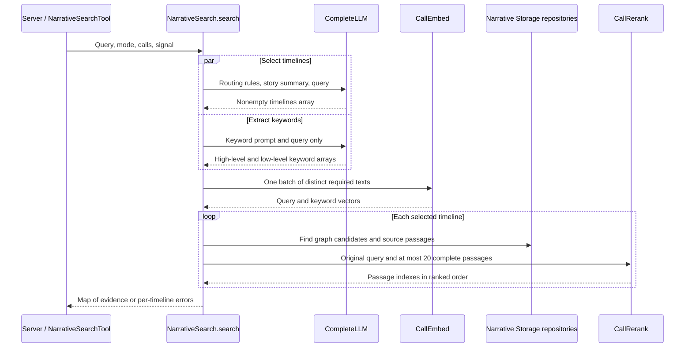

# Narrative

[中文](./README-zh.md)

This package retrieves original story passages from the three fixed timelines of Magical Girl Witch Trials. Two independent LLM requests run concurrently: one selects timelines using a fixed story summary, while the other extracts keywords from the query without that summary. Neither request rewrites the query. Retrieval and Rerank use the same incoming question. The result is evidence for the main Agent, not a generated answer.

## Use

The host opens the Narrative database, creates its Storage repositories, and provides three model-call functions:

```ts
const search = new NarrativeSearch(chunksRepo, graphRepo);
const result = await search.search(
  query,
  'hybrid',
  completeLLM,
  callEmbed,
  callRerank,
  signal,
);
for (const [timeline, value] of result) {
  if ('text' in value) {
    useEvidence(timeline, value.text);
  } else {
    showFailure(timeline, value.message);
  }
}
```

All three call functions are required. The result is a Map in routing order, containing only the selected timelines: 1st_Loop, 2nd_Loop, and/or 3rd_Loop. A successful value has text; an empty string means no usable evidence. A failed timeline has message.

Embedding must use the asset's original Pro/BAAI/bge-m3 vector space. The package checks for 1024 dimensions, but another 1024-dimensional model is not interchangeable. Stored vectors are little-endian Float32 values. The host owns provider configuration and usage records.

## Query flow



Routing follows the user's explicit timeline first. A final-outcome question with no earlier scope targets the third loop; comparisons select the needed loops. Only the timeline-selection request receives the fixed summary. Its response contains a nonempty, duplicate-free timelines array, not subquestions, keywords, or answers. The summary is not returned as evidence.

Keyword extraction uses the LightRAG v1.5.7 template with only its language, output-template, and query placeholders filled. Its request does not include the story summary, timeline response, or chat history. The prompt asks for English keywords while preserving proper names in their original language, deriving terms only from the query. High-level keywords search relationships and themes; low-level keywords search named entities and objects. Each group may be empty. All selected timelines share these keywords and the original query, after outer whitespace is trimmed. Required embedding texts are deduplicated and encoded in one batch.

The Tool caller may resolve established conversational references before calling Narrative, but must preserve uncertainty, exclusions, and the user's requested scope rather than add presumed answers or extra questions. Keeping the summary out of extraction removes that supplied source of answers; it does not guarantee that the model respects negation or never invents a term.

| Mode | Retrieval |
| --- | --- |
| local | Match low-level keywords to entities, then read their incident relations |
| global | Match high-level keywords to relations, then read their endpoint entities |
| hybrid | Alternate and deduplicate local and global results |
| naive | Search passage vectors with the original query |
| mix | Combine hybrid results and direct passage search |

Local or global can use the other side when its own keywords are absent. With both groups empty, local, global, hybrid, and mix return empty evidence; naive still searches passages.

Entity and relation searches each start with up to 40 vector candidates. These searches and direct passage search use cosine similarity with a 0.2 threshold. Graph source passages are ranked within the already selected source groups without that threshold. Entity and relation descriptions are limited before loading source passages; the descriptions themselves are not returned as evidence.

Source selection groups passages by entity or relation, deduplicates references, and uses the original query vector to select candidates. Entity-source passages are selected first; relation-source selection excludes them. Where no usable source vectors exist, earlier groups receive larger allocations. Python-style rounding preserves LightRAG's allocation behavior.

Each timeline sends at most 20 complete passages to Rerank with the original search question, not the extracted keywords. Up to 8 ranked passages are returned per timeline. Scores from separate timeline requests are not compared.

## Evidence budget, failures, and cancellation

The whole search has a 32,000 UTF-16-code-unit budget, divided equally among selected timelines. JSON escaping and newlines count. Output keeps a prefix of complete passages in ranked order and stops at the first passage that does not fit. Each line is a JSON object with chunk_id and content; its timeline is the Map key.

An empty question, either preparation-request failure, invalid response fields, or unknown or repeated timelines fails the whole search before Embedding or Rerank. Both responses may have thinking tags removed and JSON repaired, but their fields must pass their separate schemas. There is no fallback to the old combined response or invented keywords. If one request fails, an already sent sibling request may still finish and record usage; Promise.all does not cancel it.

A batch Embedding failure becomes an error for each timeline that needed embeddings. A local retrieval or Rerank failure affects its own timeline, leaving other timelines' results available. A failure does not return unranked results as if ranking had succeeded. No candidates means no Rerank call.

The same signal reaches all model calls. Cancellation is thrown to the caller rather than returned as a timeline error. Timeline tasks yield once before local retrieval, then may await Rerank concurrently. SQLite and vector calculations run on the same thread, not in workers; new cancellation events cannot run during a synchronous calculation.

## Host integration and data

Server composition in `apps/server/src/composition/narrative.ts` resolves narrative-llm, narrative-embed, and narrative-rerank bindings at Turn preparation. It records each model call's final usage with the initiating Session and Turn. Configuration changes affect the next Turn. An auto query-mode setting uses the tool's mode or hybrid; a fixed setting overrides the tool's choice.

Each of the two preparation requests uses native non-streaming completion with `maxOutputTokens: 8192`, independently of the model catalog's maximum output capacity. Each call records its own usage. This is a per-request budget, not the evidence-text budget above. Reaching the output limit fails that request rather than parsing a truncated result. Anthropic's SDK can reject excessively large non-streaming output budgets before sending HTTP; raising its timeout or switching this search to streaming is not required by this wiring.

Turn preparation supplies the search function only when the current character's name matches `isWitchTrialCharacter` and model configuration is available. The name check uses a fixed list of complete Chinese, Japanese, and English names, trims whitespace, and ignores English case. It does not change the user's tool toggles. Browser code imports the separate `@ema-agent/narrative/isWitchTrialCharacter` entry to avoid loading Node retrieval code.

That entry also exports `witchTrialCharacterNames`, the same grouped names used by the predicate. Each group starts with the Chinese full name, followed by accepted alternate full names. The character settings table renders these groups directly instead of maintaining a second list.

`NarrativeSearchTool` converts the Map into arrays for tool-result persistence and transport, derives found/partial/empty/unavailable, and exposes evidence and failure text to the model and UI.

Storage owns the fixed chunks, entities, relations, their source links, and vectors. Graph-only modes read candidate source vectors; naive and mix search all passage vectors for their timeline. Mix reuses that read for source selection. Passage text is loaded after candidate IDs are merged. Vectors and intermediate results are not retained between searches.

## Reading and verification

Read `pipeline/recall.ts` for the full flow, `router.ts` and `prompts.ts` for the independent routing and keyword requests, `query.ts` for mode selection, and `retrieval/sourceChunks.ts` for source selection. `vectors.ts` ranks vectors; `context.ts` enforces whole-passage budgets.

Run `pnpm --filter @ema-agent/narrative test` and `pnpm --filter @ema-agent/narrative typecheck`. Tests use real in-memory SQLite tables and repositories with simulated model responses. They cover concurrent preparation, isolated request content, exact keyword-template rendering, response schemas, embedding deduplication, five modes, ranking inputs and order, budgets, partial failures, and cancellation. Tool conversion is tested in `src/builtin-tools/tests/NarrativeSearchTool.test.ts`. Host request budgets and per-call usage are tested in `apps/server/tests/narrativeOutputBudget.test.ts`. These tests do not validate live model routing or the factual accuracy of the fixed summary.

Retrieval follows LightRAG 1.4.16; the keyword prompt and output template are from LightRAG v1.5.7. Its MIT license is preserved in [LICENSE.lightrag](./LICENSE.lightrag).
