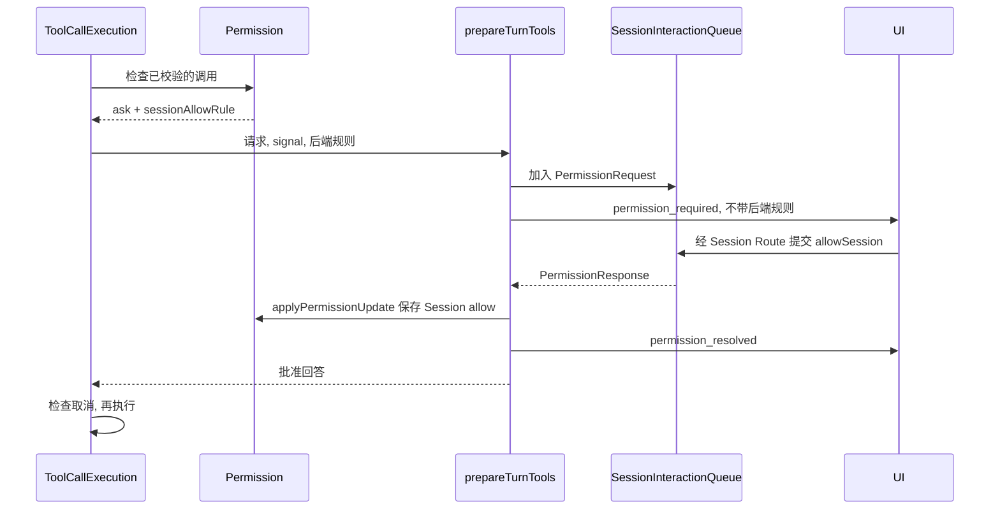

# Permission

[English](README.md)

Permission 判断已校验的工具调用是允许, 拒绝还是需要用户批准. 它读取用户和项目规则, 在内存中保存 Session 批准, 并提供工具使用的路径和命令匹配函数.

## 检查一次调用

```ts
const buckets = loadPermissionRuleBuckets(settings, sessionId, projectId);
const decision = await hasPermissionsToUseTool(
  tool,
  validatedInput,
  toolContext,
  { mode, workspaceRoots, ...buckets },
  { interactive: true },
);
```

实际调用方是 [ToolCallExecution](../tools/execution/toolCallExecution.ts). 它先解析输入, 检查执行环境并校验输入, 再询问 Permission. 工具的 `checkPermissions` 解释自身的文件, 命令或网络操作. 中央函数按以下顺序判断:

1. 用户或项目配置拒绝整个工具时, 直接拒绝.
2. 执行工具检查, 显式 deny 直接结束判断.
3. 复用匹配的 Session 内容批准. 专门范围由工具匹配, 完整输入的默认范围由中央匹配.
4. 检查整个工具的 ask 配置, 再处理工具返回的 ask.
5. bypassPermissions 放行剩余调用.
6. 检查整个工具的 allow 配置, 再处理工具返回的 allow.
7. 尚未放行的 passthrough 转为 ask. 没有交互通道时, 最终 ask 转为带 headless 原因的 deny.

用户和项目的 allow 不跳过 ask. Session 批准可以跳过同一范围的重复询问, 不能覆盖显式 deny. 同一行为的内容规则按 Session, 项目, 用户顺序查找; 整个工具的配置规则先查项目再查用户.

中央处理 default 和 bypassPermissions. 路径工具在前面的检查通过后, 实现 acceptEdits 对普通工作区写入的放行. Plan 由 Turn 准备只读 ToolPool, 模型定义和执行查找使用同一个池. 批准不能将被排除的工具加回池中.

## 回答批准请求

最终 ask 必须携带后端持有的 `sessionAllowRule`. 工具即使自行返回 allow, 也可以保留专门范围, 因为整个工具的 ask 配置仍可能要求批准. 未提供范围时, 中央使用 `input:` 加已校验输入的确定性 JSON.



前端提交 allow, allowSession 或 deny, 不生成也不接收规则内容. Allow 只允许本次执行, 不保存规则. AllowSession 先保存后端规则, 再发布 resolved 并返回回答. 拒绝, 未回答即取消和超时不保存批准. 已保存的批准也不会重新启动被取消的调用.

Permission 和 AskUser 共用 [Turn 交互队列](../turn/interactionQueue.ts) 中每个 Session 的 FIFO. 根执行与子代理使用所属 Session 的通道, 不同 Session 可以独立等待. 请求使用 toolCallId, sessionId 和 turnId; 子请求成对增加 subagentId 和 runId, 使某次执行结束时只取消自己的等待, 不清空其他批准.

## 保存的范围

| 工具 | Session 批准范围 |
| --- | --- |
| Read, Edit, Write, DescribeImage | file: 加字面绝对路径, 只对当前工具有效. |
| Glob | directory: 加字面目录, 包含该目录及后代. |
| Grep | 按本地实际目标保存文件或目录范围; UNC 使用完整输入默认范围. |
| Bash, PowerShell | 转义后的完整命令, 不自动扩大成前缀. |
| WebFetch | domain: 加精确 hostname. |
| WebSearch | search: 加搜索词及规范化的允许/排除域名列表. |
| 其他工具, 包括 MCP | input: 加完整已校验输入的确定性 JSON. |

文件批准不包含父目录或其他工具. Read 的偏移量和 Edit 的替换文本不影响文件范围. Shell 超时和后台参数不影响命令范围. WebFetch 可复用同主机的不同协议, 端口和路径, 不包含子域名. WebSearch 去除搜索词首尾空格, 规范域名大小写, 去重并排序, 不批准 WebFetch 访问.

默认完整输入规则递归忽略对象键顺序, 保留参数值和数组顺序, 不猜测 path, URL 或 command 字段含义.

## 规则和路径

配置字符串为 Tool 或 Tool(content), 解析器转义反斜杠和括号. Bash() 和 Bash(*) 等空内容或单独星号表示整个工具. 格式不完整时把完整字符串当作字面工具名.

路径规则支持 file:/directory: 字面范围, ./src/** 等相对 cwd 的 gitignore 模式, 以及 // 前缀的绝对模式. 字面范围不展开文件名中的通配字符. Shell 配置支持完整命令, npm:* 这类前缀和通配模式. 单次命令批准先转义模式字符再序列化.

`getPathsForPermissionCheck` 返回绝对路径和解析后的目标. 新文件先解析最近存在的祖先, 再补回缺失路径段. 工作区判断要求每种返回形式都位于传入的根目录内. 解析失败只保留原绝对路径, 失败本身不是拒绝决定. Windows/macOS 按平台选择忽略大小写, 不查询每个文件系统的实际配置.

文件工具先识别 UNC, 再决定是否查询文件系统, 避免批准检查本身访问网络共享. 工具分别处理显式拒绝, Session 批准和敏感路径确认. `hasSuspiciousWindowsPath` 只识别可疑写法, 是否询问由工具决定. `checkInternalPath` 按文本范围匹配宿主授予的内部目录, 本身不解析符号链接.

## 生命周期和设置

`applyPermissionUpdate` 将 Session 批准写入进程内 Map, 按序列化规则文本去重. `loadPermissionRuleBuckets` 为 Turn 固定用户/项目设置, 但通过 getter 读取 Session allow. 已创建的根执行器和子执行器能立即看到新 Session 批准.

Session 批准跨 Turn 完成, 停止, Goal 续接和 Compact 保留. 删除 Session 调用 `clearSessionRules`, 退出进程则丢失. 用户/项目规则通过 Settings 持久化到 permission.rules.user.* 和 permission.rules.project.*. 项目配置按项目 ID 保存, 启动时移除已不存在项目的条目.

批准超时设置为 permission.askTimeoutMs. 默认 null 表示不因等待时间自动超时; 数值范围为 200,000 到 600,000 毫秒. 设置变化影响新建队列条目, 只有队首启动计时. 无限等待仍可被取消结束.

## 代码与验证

[hasPermissionsToUseTool.ts](hasPermissionsToUseTool.ts) 包含判定顺序, [rules/update.ts](rules/update.ts) 和 [rules/loader.ts](rules/loader.ts) 处理规则保存与生命周期, [types.ts](types.ts) 定义后端及事件形状. [prepareTurnTools](../turn/prepare/prepareTurnTools.ts) 负责等待回答及处理顺序. 实际文件和命令检查位于 [pathPermission](../builtin-tools/tools/shared/pathPermission.ts) 和 [shellPermission](../builtin-tools/tools/shared/shellPermission.ts).

运行 `pnpm --filter @ema-agent/permission test` 和 `pnpm --filter @ema-agent/permission typecheck`. 相关工具测试检查专门批准范围和执行流程, Turn 测试检查共享批准队列及先保存再继续的顺序.
