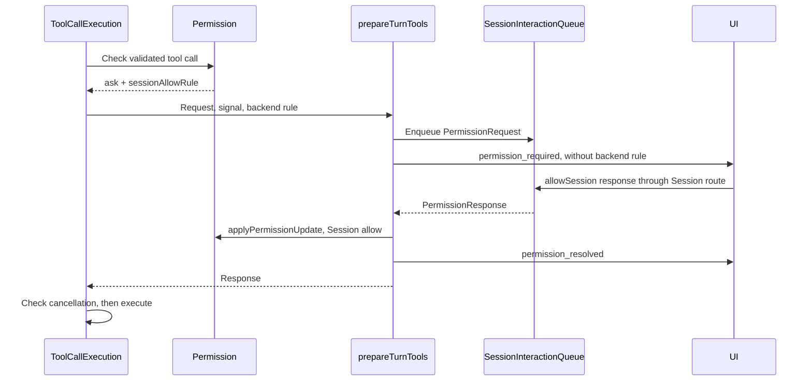

# Permission

[中文](README-zh.md)

Permission decides whether a validated tool call is allowed, denied or needs the user's approval. It loads user and project rules, keeps Session approvals in memory, and provides the path and command matchers used by tools.

## Checking a call

```ts
const buckets = loadPermissionRuleBuckets(settings, sessionId, projectId);
const decision = await hasPermissionsToUseTool(
  tool,
  validatedInput,
  toolContext,
  { mode, workspaceRoots, ...buckets },
  { interactive: true },
);
```

The real caller is [ToolCallExecution](../tools/execution/toolCallExecution.ts). It parses input, checks the tool's execution context and validates input before asking Permission. A tool's `checkPermissions` interprets its own file, command or network operation. The central function applies this order:

1. Deny if user or project configuration denies the whole tool.
2. Run the tool's check; an explicit deny ends the decision.
3. Reuse a matching Session content approval. Tools match their dedicated scopes; the central function matches its complete-input fallback.
4. Apply whole-tool ask rules, then the tool's ask result.
5. Allow remaining calls in bypassPermissions mode.
6. Apply whole-tool allow rules, then the tool's allow result.
7. Convert an unresolved passthrough to ask. Without an interaction channel, convert a final ask to deny with a headless reason.

User and project allow rules do not skip an ask. Session approval can skip a repeated ask for the approved scope, but cannot override an explicit deny. Within the same behavior, content-rule lookup checks Session, project and user sources in that order. Whole-tool configuration checks project before user.

The central function handles default and bypassPermissions. Path tools implement acceptEdits for ordinary workspace writes after their earlier checks. Plan mode is enforced by a read-only ToolPool prepared by Turn; the same pool supplies model definitions and execution lookup. Permission approval does not add excluded tools to that pool.

## Answering an approval

Every final ask carries a backend-only `sessionAllowRule`. Tools may supply a dedicated scope even when their own result is allow, because a whole-tool ask rule can still require approval. If no scope is supplied, the central function creates `input:` followed by deterministic JSON of the validated input.



The UI sends allow, allowSession or deny; it does not invent or receive rule content. Allow runs once without saving a rule. AllowSession saves the backend rule before publishing resolved and returning the response. Denial, unanswered cancellation and timeout do not save an approval. A saved approval does not restart a cancelled call.

Permission and AskUser share a FIFO per Session in [Turn's interaction queue](../turn/interactionQueue.ts). Root and child runs use the same Session channel; different Sessions can wait independently. Requests use toolCallId, sessionId and turnId. Child requests additionally carry subagentId and runId together, so cleanup can cancel one run's waiting calls without clearing another's approvals.

## Saved scopes

| Tool | Session approval scope |
| --- | --- |
| Read, Edit, Write, DescribeImage | file: plus a literal absolute path, for that tool only. |
| Glob | directory: plus a literal directory and its descendants. |
| Grep | A file or directory scope based on the actual local target; UNC uses the complete-input fallback. |
| Bash, PowerShell | Escaped complete command, not an automatically widened prefix. |
| WebFetch | domain: plus the exact hostname. |
| WebSearch | search: plus query and normalized allowed/blocked domain lists. |
| Other tools, including MCP | input: plus the complete validated input as deterministic JSON. |

File approval does not include parent directories or other tools. Read offsets and Edit replacement text do not change the file scope. Shell timeout/background fields do not change the command scope. WebFetch hostname approval can cover different schemes, ports and paths on that host, not subdomains. WebSearch trims the query and normalizes domain-list casing, duplicates and order; it does not grant WebFetch access.

The fallback ignores object-key order recursively but preserves values and array order. It does not infer the meaning of path, URL or command fields.

## Rules and paths

Configuration strings use Tool or Tool(content). The parser escapes backslashes and parentheses. Empty content and a single wildcard, such as Bash() and Bash(*), mean the whole tool. Malformed wrappers are treated as literal tool names.

Path rules support literal file:/directory: scopes, cwd-relative gitignore patterns such as ./src/**, and absolute patterns with a // prefix. Literal scopes do not expand wildcard characters in filenames. Shell configuration supports exact commands, prefix rules such as npm:*, and wildcard patterns. A stored one-command approval escapes wildcard characters before serialization.

`getPathsForPermissionCheck` returns the absolute path and resolved targets. For new files it resolves the nearest existing ancestor before restoring missing segments. Workspace membership requires all returned forms to fall within supplied roots. If resolution fails, only the original absolute path remains; resolution failure itself is not a deny decision. Comparison ignores case on Windows/macOS by platform choice, not by querying each filesystem.

File tools identify UNC paths before filesystem queries, so approval checks do not themselves contact a network share. They separately check explicit denies, Session approvals and sensitive-path confirmation. `hasSuspiciousWindowsPath` identifies unusual names; the tool decides whether to ask. Host-granted internal roots use text containment through `checkInternalPath`; that helper does not resolve symlinks.

## Lifetime and settings

`applyPermissionUpdate` writes Session approvals to an in-process Map, deduplicated by serialized rule text. `loadPermissionRuleBuckets` captures user/project settings for a Turn but reads Session allow rules through a getter. Existing root and child executors therefore see new Session approvals immediately.

Session approvals survive Turn completion, stopping, Goal continuation and compaction. Session deletion calls `clearSessionRules`; process exit loses them. User/project rules persist through Settings under permission.rules.user.* and permission.rules.project.*. Project records are keyed by project ID, and startup removes entries for projects that no longer exist.

The approval timeout setting is permission.askTimeoutMs. Its default null means no timeout; numeric values range from 200,000 to 600,000 milliseconds. Changes affect new queue entries, and only the FIFO head's timer runs. Cancellation can still end an indefinite wait.

## Code and checks

Read [hasPermissionsToUseTool.ts](hasPermissionsToUseTool.ts) for decision order, [rules/update.ts](rules/update.ts) and [rules/loader.ts](rules/loader.ts) for storage/lifetime, and [types.ts](types.ts) for backend and event shapes. [prepareTurnTools](../turn/prepare/prepareTurnTools.ts) owns approval waiting and response ordering. Concrete file and command checks live in [pathPermission](../builtin-tools/tools/shared/pathPermission.ts) and [shellPermission](../builtin-tools/tools/shared/shellPermission.ts).

Run `pnpm --filter @ema-agent/permission test` and `pnpm --filter @ema-agent/permission typecheck`. Related tool tests check dedicated scopes and the execution pipeline; Turn tests check the shared approval queue and saving before continuation.
