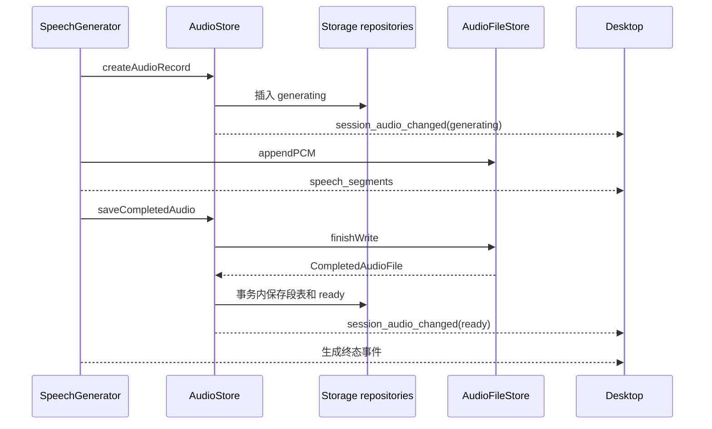

# Speech

[English](./README.md)

Speech 把助手正文变成按顺序执行的 TTS 请求, 完整 WAV 和字幕段. Server 共用一个 SpeechGenerator 和一个 AudioStore. 每次生成独立 audioId, 同一个 Turn 和角色可以保留多条音频.

Turn 执行, 语音生成和实际播放分别结束. 停止播放不会取消生成.

## 生成与存储

Storage 完成迁移后创建 AudioStore, 传入音频根目录和 AudioRecordEvent 通知回调. SpeechGenerator 接收该 Store, UsageRecorder 和 SpeechGenerationEvent 回调.

StartTurnSpeechInput 固定 Session, Turn, 角色, Provider, 模型, TTSConnection 和 TTSVoiceReference. Server 解析角色配置, Speech 不导入 Characters. startTurnSpeech 先插入 generating 记录, 再准备声音或创建文件, 返回活跃 Map 中的同一个对象. 登记失败就停止本次尝试.

appendTextDelta 清理代码/数学块和行内标记后分句. 逐句合成, 每句最多 200 个 UTF-16 单元, 超时 120 秒, PCM 上限 16 MiB. 写入回调成功后才增加 writtenPCMBytes 并唤醒读者. 每个 TTS 请求分别记录用量.

当前数据目录下的路径为:

```text
audio/<sessionId>/<turnId>/<characterName>-<audioId>.wav.tmp
audio/<sessionId>/<turnId>/<characterName>-<audioId>.wav
```

AudioFileStore 独占创建临时文件. finishWrite 结束写入, 截去未确认的尾部, 补齐 WAV 头, 只改名本次生成的文件. 返回的 CompletedAudioFile 表示文件完成, 不表示 SQL 已经 ready.

AudioStore.saveCompletedAudio 在一个事务内保存段表并改为 ready. 每条音频按 audioId 插入, 不替换以前的结果. endTextInput 只结束正文输入; generationCompletion 等待保存或清理完成, 不等待前端播放.

| 对象 | 职责 |
| --- | --- |
| AudioOutputStore | 从 Database 创建 SpeechOutputsRepo, 把 SQL 行转为音频记录和 Summary. |
| AudioSegmentStore | 管理实时段信息, 通过 SpeechSegmentsRepo 读写已完成的段. |
| AudioFileStore | 写入, 改名, 读取和删除文件, 管理活跃文件读者和写入流. |
| AudioStore | 协调 SQL 记录, 文件完成, 失败清理, 删除和记录通知. |

SQL 放在 Storage. 音频记录的 audio_status 为 generating, ready, deleting 或 failed. 大小和时长未知时为 null; SQL 要求 ready 时两者都已确定. AudioSummary 返回身份, 角色, 状态, 创建时间, 大小, 时长和失败原因, 不包含文件正文或段表.

文件层另有 writing, closing 和 closed 三个写入状态. closed 通知读者不会再有 PCM, 不表示 SQL 保存成功.

## 段信息, 读取与通知

一段 TTS 的第一块 PCM 成功写入后才建段. textForTTS 是实际提交文本, startMs/endMs 是 PCM 时间轴位置, 不含模型和网络等待. 当前句结束前 endMs 为 null. 中断时可能只有提交文本的前半段音频, 不提供逐字语音对齐.



AudioRecordEvent 只在对应 SQL 操作成功后发送. deleted 表示记录已删除, 不作为 SQL 状态保存. 生成器的段事件和终态描述语音生成, 不表示播放结束. 通知失败不撤销已保存的记录.

实时读者各自持有句柄和位置, 每次最多读取 64 KiB. 到当前尾部时等待新 PCM 或 closed. 关闭读者只取消这次读取. 读者可以先于 SQL 保存结束. 生成中响应不带 Content-Length, 完成文件返回真实大小. HTTP 读取在改名期间只查该 audioId 的临时和最终路径.

Server 在 /api/audio/:audioId 下提供按 ID 查询播放信息, 文件, 记录和删除的认证接口. 已有音频按保存路径读取. 元数据接口要求请求头认证, 原生 audio 的文件 GET 另允许 URL 中的进程口令.

## 失败, 删除与启动

自动生成取消后可以保存已写入 PCM. 单句供应商错误提示警告后继续后续句子, 文件错误或格式改变则停止后续合成. 手动生成必须全部成功, 失败或取消只清理本次音频.

discardFailedAudio 关闭该 ID 的读者和写入流, 先删文件, 后删 SQL. 清理失败保留 failed 和 failureMessage. 如果连失败状态也无法保存, 如实报告错误, 不声称记录已经改变.

deleteAudio 先保存 deleting 并通知前端. generating 不允许直接删除, 同 ID 的并发删除请求等待同一次操作, 新读取被拒绝. 已有读者关闭后才删除文件. 临时和最终文件都不存在后才删记录, 段表级联删除. 失败时尽可能保留 failed 记录供重试. 对已经不存在的记录重复删除会成功返回.

Server 接受请求前, markInterruptedAudioRecordsFailed 将遗留 generating/deleting 改为 failed. 不重新执行 TTS, 不静默删除文件. Data 可以重试清理, 不提供全目录自动修复.

## 前端与试听

Chat 的播放二级菜单只列当前激活角色已经 ready 的音频, 明确选择 audioId. 播放器按 currentTime 和该 ID 的段表驱动字幕和口型. 显字是视觉动画, 缓冲时暂停. 媒体 ended 事件才交接展示 owner.

Data 按 Turn 和角色折叠. 只给选中的一条挂载普通播放器, 切换条目会停止前一条, 收起对应分组会停止播放. Data 提供删除和在文件夹中显示, 不显示字幕或驱动口型. Chat 和 Data 平时不互相停止, 删除某个 ID 时则停止同 ID 的播放.

VoiceRegistrationCache 按角色, 资源版本, Provider 和模型复用注册成功的云端声音, 本地参考声音不缓存. previewVoice 在内存返回完整 WAV, PCM 上限 16 MiB, 不创建 Turn 音频记录.

## 验证与限制

```sh
pnpm --filter @ema-agent/speech test
pnpm --filter @ema-agent/speech build
```

测试使用模拟 TTS, 临时文件和内存数据库, 覆盖先登记后写入, 段时间, 多条保留, 清理失败, 删除并发和启动状态处理. Server 测试检查按 ID 认证的 HTTP, Desktop 测试检查 owner 和真实浏览器里的菜单/播放器交互.

这些检查不代表真实供应商音质或已安装 WebView 已验证. 整轮待合成文本没有容量上限. 过滤使用启发规则, 普通 WAV 大小限制和长录音需另做运行验证.
