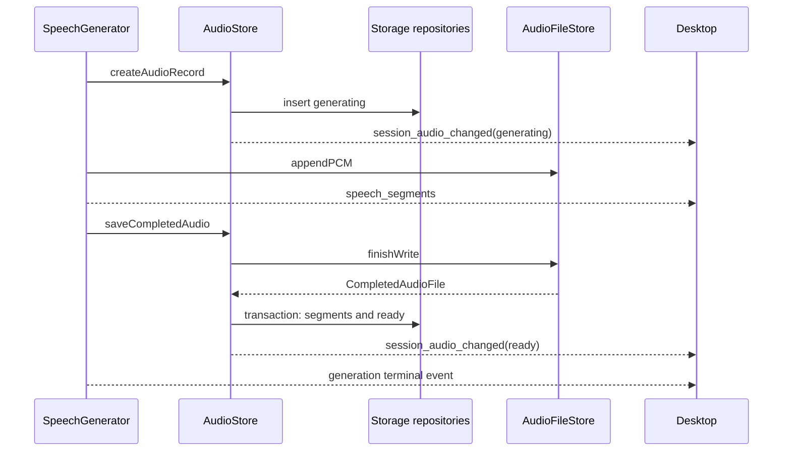

# Speech

[中文](./README-zh.md)

Speech turns assistant text into sequential TTS requests, complete WAV files, and caption segments. One SpeechGenerator and one AudioStore serve Server. Each generation has its own audioId. A Turn and character can retain multiple recordings.

Turn execution, audio generation, and playback finish independently. Stopping playback does not cancel generation.

## Generation and storage

Create AudioStore after Storage migrations, supplying the audio root and a callback for AudioRecordEvent. SpeechGenerator takes this store, UsageRecorder, and a callback for SpeechGenerationEvent.

StartTurnSpeechInput fixes the Session, Turn, character, Provider, model, TTSConnection, and TTSVoiceReference. Server resolves character configuration; Speech does not import Characters. startTurnSpeech registers a generating SQL record before preparing the voice or creating a file, and returns the same object held in the active-generation Map. Registration failure stops the attempt.

appendTextDelta filters code/math and inline markup, then queues sentences. Sentences run sequentially, each limited to 200 UTF-16 units, 120 seconds, and 16 MiB PCM. A write callback must succeed before writtenPCMBytes increases and readers are notified. Each TTS request records usage separately.

The paths under the active data directory are:

```text
audio/<sessionId>/<turnId>/<characterName>-<audioId>.wav.tmp
audio/<sessionId>/<turnId>/<characterName>-<audioId>.wav
```

AudioFileStore creates the temporary file exclusively. finishWrite closes the writer, truncates unconfirmed bytes, patches the WAV header, and renames only this generation's file. It returns CompletedAudioFile, which means the file is finished, not that SQL is ready.

AudioStore.saveCompletedAudio saves segments and changes the record to ready in one transaction. Different recordings are inserted by audioId, without replacing earlier recordings. endTextInput only closes text input; generationCompletion waits for saving or cleanup, not desktop playback.

| Object | Responsibility |
| --- | --- |
| AudioOutputStore | Constructs SpeechOutputsRepo from Database and converts SQL rows into records and summaries. |
| AudioSegmentStore | Holds live segments and reads or saves completed segments through SpeechSegmentsRepo. |
| AudioFileStore | Writes, renames, reads, and deletes files; owns active file readers and writers. |
| AudioStore | Coordinates SQL records, file completion, failure cleanup, deletion, and record notifications. |

SQL remains in Storage. The audio record's audio_status is generating, ready, deleting, or failed. File sizes and durations are null until known; SQL requires both for ready. AudioSummary returns identity, character, status, creation time, size, duration, and failure reason, without file bodies or segment tables.

File writers separately use writing, closing, and closed. closed tells readers that no more PCM will arrive. It does not mean that SQL saving succeeded.

## Segments, reads, and notifications

The first successfully written PCM block starts a segment. textForTTS is the submitted text; startMs/endMs measure the PCM timeline, excluding model and network waits. endMs is null until that sentence ends. Interrupted synthesis can contain only the beginning of the submitted text. There is no word-level speech alignment.



AudioRecordEvent is emitted only after its SQL change succeeds. Its deleted value means the row was removed; deleted is not stored as an SQL status. The generator's segment and terminal events describe synthesis, not playback completion. A notification failure does not undo saved records.

Live readers use independent handles and offsets, reading at most 64 KiB at a time. They wait at the current end for more PCM or closed. Closing a reader cancels that read only. Readers can finish before SQL saving finishes. In-progress responses omit Content-Length; completed files report their size. The HTTP reader follows this audioId's temporary/final paths across rename.

Server provides authenticated ID-based playback, file, record, and deletion routes under /api/audio/:audioId. Existing recordings use their stored paths. Metadata requires request-header authentication; native audio file GET also accepts the process secret in its URL.

## Failure, deletion, and startup

Automatic generation can save written PCM after cancellation. A provider error in one sentence warns and permits later sentences. A file error or format change stops later synthesis. Manual generation must succeed completely; failure or cancellation cleans only this attempt.

discardFailedAudio closes this ID's readers and writer, then removes its files before removing SQL. Cleanup failure retains failed and failureMessage. If saving that failure state also fails, the operation reports that error rather than claiming a persisted transition.

deleteAudio first saves deleting and notifies clients. It rejects generating recordings, merges concurrent deletion requests for the same ID, and blocks new reads. Existing readers are closed before file removal. Only after both temporary/final files are absent does SQL delete the record; segments cascade. Failure retains a failed record for retry when possible. Repeated deletion of an absent record succeeds.

Before Server accepts requests, markInterruptedAudioRecordsFailed changes leftover generating/deleting rows to failed. It does not restart TTS or silently delete files. Data can retry cleanup. No automatic whole-directory repair is performed.

## Desktop and preview

Chat's playback submenu lists ready recordings for the active character and selects an explicit audioId. Its player uses currentTime and that ID's segments for captions and lip sync. Character reveal is visual animation; buffering pauses it. The media ended event releases the presentation owner.

Data groups recordings by Turn and character. Only the selected recording mounts its ordinary player; selecting another stops the previous one, and collapsing the selected group stops it. Data has deletion and folder-reveal controls, without captions or mouth control. Chat and Data do not stop each other during ordinary playback. Deleting an ID stops any playback of that same ID.

VoiceRegistrationCache reuses successfully registered cloud voices by character, resource version, Provider, and model. Local references are not cached. previewVoice returns a complete in-memory WAV, capped at 16 MiB PCM, without creating Turn records.

## Verification and limits

```sh
pnpm --filter @ema-agent/speech test
pnpm --filter @ema-agent/speech build
```

Tests use mocked TTS, temporary files, and in-memory databases. They cover SQL-first creation, segment timing, retained recordings, cleanup failures, deletion races, and startup state changes. Server tests verify ID-based authenticated HTTP; Desktop tests verify ownership and real browser menu/player interactions.

These checks do not establish real provider voice quality or installed-WebView behavior. Queued text has no whole-Turn capacity limit. Filtering is heuristic, and ordinary WAV size limits and long recordings require separate runtime checks.

