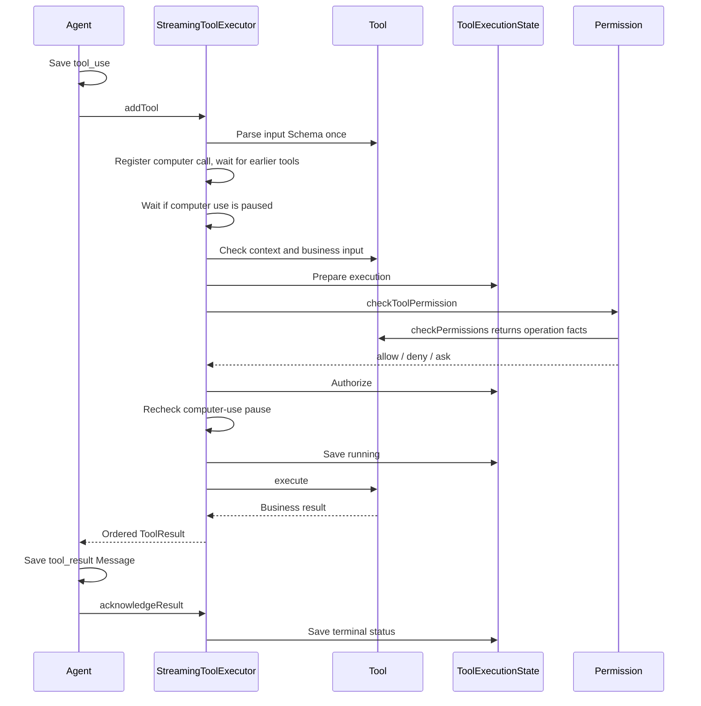

# Tools

[中文](./README-zh.md)

This package defines tools, selects an ordered ToolPool, runs calls with permission checks, records execution states, and stores large results. It also runs Shell commands that may continue in the background.

## Define and assemble tools

Use `buildTool()` with an input Schema, `validateContext`, permission checks, and `execute`. A tool returns its business result; `mapResultToModelContent` selects what the model receives. Without a custom mapping, strings pass through and other values become JSON.

Turn supplies `ToolExecutionContext` to the executor with execution identity, cancellation, the ToolPool, Permission, result storage, and computer-use callbacks. Individual tools use `validateContext` to select capabilities from `ToolUseContext` in `interface/`. Subagent control and user-question contracts are defined beside it. `ToolInvocation` carries Session, Turn, tool-call identity, and cancellation separately.

`ToolRegistry` holds implementations. Built-ins register individually; an MCP batch is checked for name, ID, and source conflicts before any replacement. `assembleToolPool()` puts built-ins first and orders MCP tools by their original Server/tool identities. Callers filter this Pool for settings, permission mode, and main/subagent scope.

The Pool keeps the same Tool objects and does not reread the Registry. MCP changes therefore affect later preparation, not an already prepared Turn. Environment availability is checked when a tool is called, not while building the list.

## Run a call

`StreamingToolExecutor` is the public execution entry. The Agent saves a tool-use message before calling `addTool()`.

Schema parsing happens once. Invalid input and missing context fail before permission checks. With no approval channel, a decision requiring approval is denied. Session approval rules are saved by the host; see [Permission](../permission/README.md).

Turn supplies `registerComputerToolCall` to register the four computer tools in ComputerUse by tool-call ID. Ordinary tools are not registered. On pause or termination, ComputerUse invokes `cancelPendingComputerCall` for old calls that can be invalidated immediately. Keyboard and mouse actions already sent to Rust return their actual result, including possible partial completion. The executor calls the returned cleanup function when processing finishes; it removes the registration and releases an unapproved startup reservation.

Turn's `waitIfComputerUsePaused` makes ordinary tools wait for this Session's computer use to resume or end. While termination is in progress, they wait for it to finish. The executor checks after scheduling and again after Permission, before execution. Cancelling the Tool or Turn interrupts this wait. Computer calls do not wait here for replay, and subagents receive neither callback.

Calls are indexed by tool-call ID. The block-order list refers to those same records and is sorted when new calls arrive. Queued cancellation and ordinary execution use one call pipeline. A cancelled call can produce its result without waiting for an earlier long-running tool. Scheduling still waits for that earlier work, so later tools cannot use the cancellation to start out of order.

Concurrency-safe calls can run together, but must wait for an earlier exclusive call. An exclusive call waits for all earlier calls and blocks later ones. Results and terminal events are delivered by model block order even if execution finishes out of order. Progress events are forwarded as they occur.

Call `acknowledgeResult()` only after saving the result Message. `running` is saved before invoking the tool. Cancellation after that point may leave side effects, so execution state becomes `outcome_unknown` even when the model-facing result says cancelled, unless ComputerUse has confirmed through its cancellation callback that the action was not submitted. State writes use version checks to prevent late completions from overwriting newer decisions.

Shutdown cancels calls and waits up to five seconds by default. Calls still running after the wait have their later events suppressed and their execution state closed according to whether execution started. Each model iteration creates its own executor.

## Results and file state

`ToolResult.content` is model-visible and saved once. `data` keeps the business result for UI and history consumers. Multimodal content passes through; the tool must keep it within its own limits.

Text defaults to a 50 KiB per-tool budget. `ToolResultStore` saves oversized text under `data/tool-results/<sessionId>/` and returns its path plus a UTF-8-safe preview of at most 2,000 bytes. If saving fails, the current implementation returns the original text. The budget is therefore not a guaranteed upper bound during disk failure.

`ToolResultCleaner` receives the `data/tool-results/` root. `ToolResultCleaner.sweep()` removes expired files after seven days, then enforces 50 MiB per Session and 500 MiB overall, oldest first. It uses up to eight file operations at a time. The host decides when to call it.

`FileStateCache` is shared within a Session across Turns and subagents. Its LRU holds at most 100 entries and 25 MiB of text. Range reads retain their range; a newer modification time can only be accepted using normalized full-text equality when the cached read was complete. Session deletion and Server shutdown release the cache. It is not rebuilt from messages.

## Shell background processes

`BackgroundProcess.runCommand()` accepts a `CommandStarter` and uses its `start`, `completion`, and `stop` handle. Bash and PowerShell supply their own command preparation.

- Normal calls start without a separate process-slot queue. A command completing within 180 seconds returns a normal result and removes its temporary logs without keeping a process row. Tool-level permission and concurrency checks still apply.
- After 180 seconds, the same process is recorded as running in the background. It keeps its logs; the original Turn's cancellation signal and progress callback are detached. It does not consume an explicit-background queue slot.
- The Scheduler acquires and releases running slots. A slot is released once, after process cleanup. Queued status is saved and published before the Scheduler can start the process.
- Explicit background calls are stored immediately and start in FIFO submission order across Sessions as slots become available. Their concurrency setting defaults to 32, with a range of 1-128. It limits explicitly backgrounded commands, not all running Shell processes. Cancelling a queued call removes it without starting a process or releasing a running slot.
- Maximum runtime defaults to 24 hours, configurable from one to 168. A command can request a shorter timeout. The timeout is fixed when submitted, starts when execution starts, and excludes queue time.
- Session work permission is checked both at submission and before starting a queued command.
- Log writing failure stops the command and reports failure. UI progress callback failure only disables that callback.
- stdout and stderr each retain up to 16 MiB including a truncation notice. Output reads use separate byte offsets and return at most 64 KiB per stream; optional waiting is capped at 30 seconds.
- Normal completion, failure, and timeout save logs and terminal state before notifying the host with an execution reference. Full output is read separately.
- `stopForSession()` requests all foreground, background, and queued commands to stop, then waits. `discardSession()` closes logs before permanent Session deletion. Startup recovery marks recorded queued/running work interrupted rather than rerunning it.

## Reading and verification

Start with [Tool](./definition/tool.ts), [assembly](./assembly/assembleToolPool.ts), and [StreamingToolExecutor](./execution/streamingToolExecutor.ts). The per-call order is in [toolCallExecution.ts](./execution/toolCallExecution.ts). Background transfer and shutdown are in [backgroundProcess.ts](./background/backgroundProcess.ts).

Run `pnpm --filter @ema-agent/tools test` and `pnpm --filter @ema-agent/tools typecheck`. Tests cover registration conflicts, scheduling, result persistence acknowledgement, cancellation, result files, and background execution with temporary SQL and log directories. Background tests also start a real Node child process to check log-write failures.
