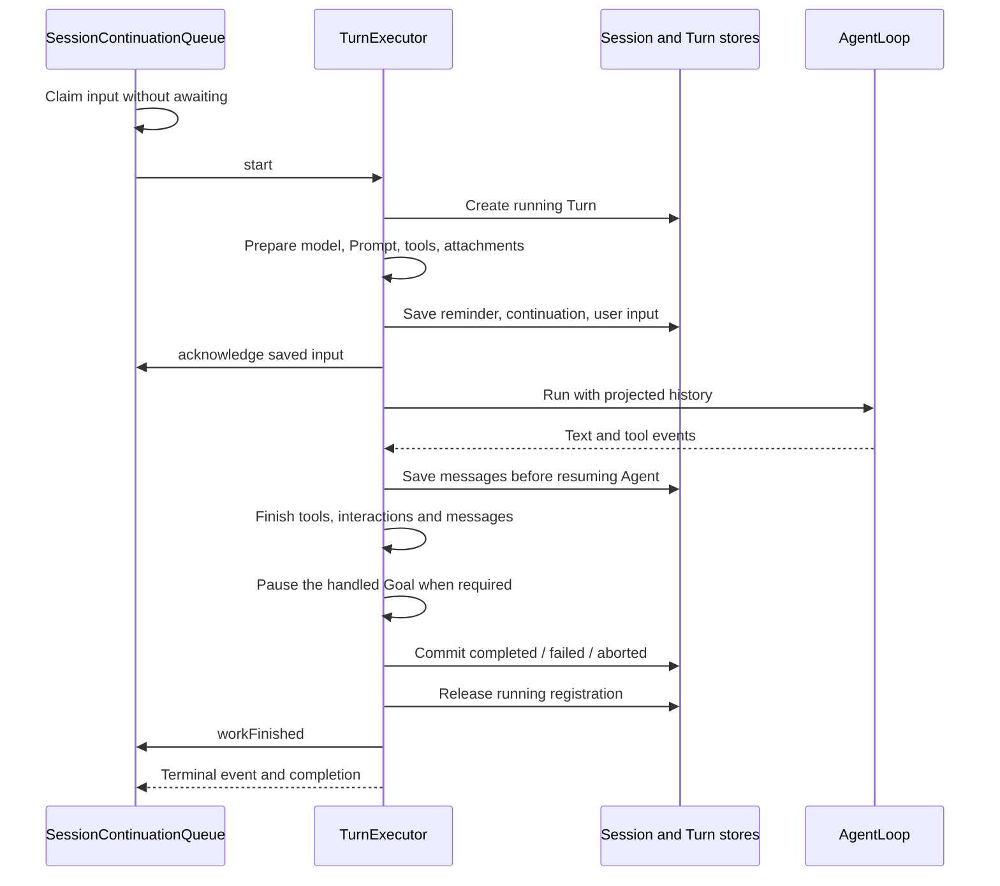

# Turn

[中文](./README-zh.md)

This package queues Session input and executes one Turn. `SessionContinuationQueue` decides when to deliver input. `TurnExecutor` prepares the model and tools, saves messages, runs AgentLoop, and finishes the execution before releasing the Session.

## Start and finish

Server creates the queue, executor, and a shared `SessionRunningRegistry`. The Registry allows one Turn or manual Compact per Session. Queue `startTurn` calls `TurnExecutor.start()`; `attachTurn` must consume the returned handle's event stream. `completion` provides the final outcome.

Model identity, reasoning effort, tools, permission mode, persona, and TTS choice are prepared for this Turn. Settings changed later apply to later preparation. Session permission approvals can still be shared with current and subsequent calls.

The reminder is saved before user input and reused in subsequent iterations. Task reminder delivery is acknowledged only after this Message is saved. Internal continuation text is a separate hidden Message; it does not impersonate user input.

Completed Turn writes and the host's Memory extraction registration share one SQL transaction. Final messages, tool shutdown, interaction cleanup, and any required Goal pause happen before releasing the Session. Deletion coordination uses `abortAndAwait()`, not just an abort signal. Scratchpad cleanup waits for derived background subagents without keeping the finished Turn registered.

`TurnHandle.events` allows one consumer. Calling its iterator's `return()` requests cancellation. A paused consumer does not automatically cancel the Turn, and the current event buffer has no size limit. Cleanup failures produce a failed outcome when its terminal record can be saved. Failure to save that terminal record rejects completion; a successful finish is not broadcast.

Computer-use pause belongs to the Session. The main Agent waits at Turn preparation, before a model request and before starting ordinary tools. Old computer calls immediately return non-execution or actual partial-operation results; they are not kept waiting for replay. Resume and control termination release the wait without adding a queued message or cancelling the Turn. Stopping generation also ends the Session's computer use when cancellation occurs before tool preparation completes. Subagents do not receive these callbacks. See [Computer use](../computer-use/README.md).

## Queued input and continuation

All ordinary sends use `enqueue()`, whether idle, running, or manually compacting. The queue is in memory and does not survive a restart. `canStartIdleTurn()` checks whether idle-only input is currently acceptable; `enqueueIfIdle()` repeats that check and enqueues without an intervening await. Screen capture checks before capture and again after saving the image.

| Delivery point | Priority |
| --- | --- |
| New Turn | Merge queued user inputs first, otherwise background notices, otherwise an active Goal continuation. User input can also carry a short Goal continuation. |
| Between completed Agent iterations | Latest active Goal edit, then background notices, then inputs marked for immediate guidance. |
| Failed or aborted work | Return all unsaved user inputs to the draft in submission order. Already saved messages remain saved. |

Guidance does not interrupt an active tool. AgentLoop checks it after the Assistant and its tool results form a complete batch, including after a text-only reply. Text inputs merge with blank lines; attachments and Skill references keep their order.

Claims are temporary. Save their Message, then call `acknowledge()`; release them if preparation or saving fails. `user_message_stored` includes the consumed queue IDs so the UI can replace waiting bubbles with persisted messages. Those IDs are not SQL fields.

`ClaimedSessionContinuation.inputKind` identifies the claimed content. `messageInput` carries text and attachments, including automatic screen captures, and can include `continuationText` when a new Turn has an active Goal. The `continuationText` branch carries only an internal notice or Goal instruction, which Turn saves as a hidden `continuation` Message. The queue separately uses `ContinuationClaim` to track which inputs or notices must be acknowledged; that consumption record is not sent to the model.

Background notices contain execution IDs and status, not full output. Models use `SubagentAwait` or `ProcessOutput` for details. Notices are deduplicated while pending. Reading a subagent's full terminal result removes an unclaimed notice.

Goal edits are bound to the Turn running when the edit occurred and read the latest SQL objective at delivery. Multiple edits before delivery collapse to the latest text. An active Goal can continue in another Turn when the current iteration limit is reached; a completed Turn does not itself mean the Goal succeeded. Stop or failure pauses the same handled Goal if it is still active, including a newer version of that identity. Closing a Goal does not directly abort the current Turn.

Goal-wide token limits and cross-Turn no-progress detection are not implemented. Current limits apply to individual Turns, not the entire Goal.

Archive and delete coordination close new Session work before clearing its pending inputs and notices. Late notices are ignored while archived. Shutdown stops the queue before stopping execution.

## Context and saved messages

`prepareContextInput()` is shared by real execution and idle context estimation. It prepares Prompt and tool definitions without starting a Turn, creating an executor, or calling a model. Idle estimation projects saved effective history, not the current draft or a future reminder. Image handling follows [Context](../context/README.md).

`TurnMessageWriter` creates an Assistant row on its first nonempty content and updates it by block index. A completed tool-use block is saved before AgentLoop starts the call. Each tool result is saved in a separate user Message before execution acknowledgement. On interruption, incomplete Assistant content is marked interrupted and missing tool results receive cancellation placeholders.

Stage control tags are removed before saving and publishing text. The character's stable name is saved on the Turn for Memory and historical facts. At Turn start, the previous character is read once for this Session, excluding the new Turn. When it differs from the frozen current name, a switch section is added inside the existing reminder before user input is saved. That section identifies the previous segment and the speaker until the next switch reminder. Same-character Turns do not repeat it. Projection replays saved messages without adding character labels or rewriting earlier reminders. Model-source resolution remains necessary for native reasoning replay.

Per-call usage is recorded separately from Context occupancy. Main calls update the Session context meter; subagent calls contribute usage records without replacing that meter. Provider input counts can correct an estimate, and appended messages return it to an estimate.

Automatic titles use only the first normal user Message while the title remains default. Explicit text takes precedence over pasted previews, then files/images, then Skill names. Titles use at most 30 grapheme clusters and do not call a model. Naming failure does not discard a saved Message.

## Compact and fork

Before each model request, `createPrepareAgentIteration()` assembles the complete effective message array and lets Compact modify it. System Prompt and tools contribute to the request budget but are not stored as ordinary history messages.

Turn and subagents share `ModelMessageIds` from Agent to align model positions with saved messages. Output-length continuation notices are saved before the next request. Entries without a stored message use `undefined`. Macro locates the last saved ID in its covered prefix and replaces that prefix with the new summary ID; array positions alone cannot identify SQL coverage.

A new fork binds to one parent request's fixed prefix and waits for its complete Assistant to be saved. Sibling forks share one deferred prefix build. Cancelling one child only cancels that child's wait. Parent failure releases waiters. Continued subagent identities reuse their own history instead of importing the parent again.

Subagents use an independent Compact closure, their own message table, and a working Prompt without the active persona. Their tools are a subset of the parent's Pool. They do not receive Memory queries, Goal/Task management, recursive Subagent dispatch, or AskUser. Native model reasoning is replayed according to its recorded generation source.

## Interaction and Plan mode

`SessionInteractionQueue` mixes Permission and AskUser in one FIFO per Session. Only the head can be answered or time out; queued entries do not consume timeout time. Different Sessions wait independently. Turn cleanup leaves subagent Run approvals alone. Run cleanup and Session cleanup remove their own requests.

Approval events use the host's Session publication channel rather than the parent Turn stream. Session approval is saved before publishing resolution and allowing execution. Cancelling an AskUser request produces a cancelled outcome, not a successful empty answer.

Plan mode filters tools at preparation using explicit built-in IDs. It keeps investigation and reading, including Capture, Memory, Narrative, and selected Task/Scratchpad reads. Shell, write, Subagent, AskUser, and MCP tools are excluded. An allow rule cannot restore an excluded tool.

`core/turnInputWriter.ts` handles initial and queued inputs through the same saving and title logic. `core/turnTermination.ts` owns cleanup and terminal persistence. `tools/` binds capabilities and interactions; `policy/` applies Plan and subagent restrictions by stable IDs.

## Reading and tests

Start with [sessionContinuationQueue.ts](./continuation/sessionContinuationQueue.ts) and [turnExecutor.ts](./core/turnExecutor.ts). Then follow [prepareTurn.ts](./prepare/prepareTurn.ts), [prepareAgentIteration.ts](./prepare/prepareAgentIteration.ts), [turnMessageWriter.ts](./core/turnMessageWriter.ts), and [turnLoopEvents.ts](./core/turnLoopEvents.ts).

Run `pnpm --filter @ema-agent/turn test` and `pnpm --filter @ema-agent/turn typecheck`. Tests use prepared model events and temporary/in-memory storage to verify queue delivery, SQL messages, permission lifetimes, Compact IDs, fork timing, context usage, and final cleanup. No paid model call is required.
